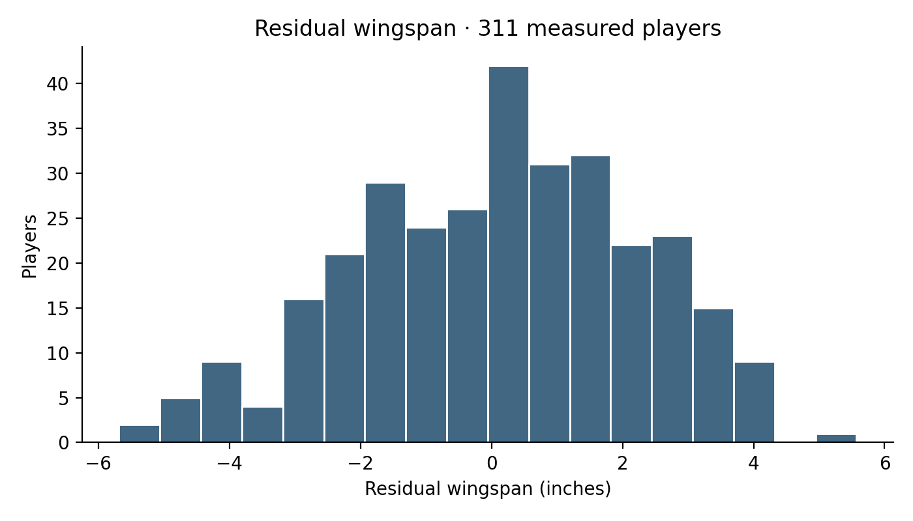
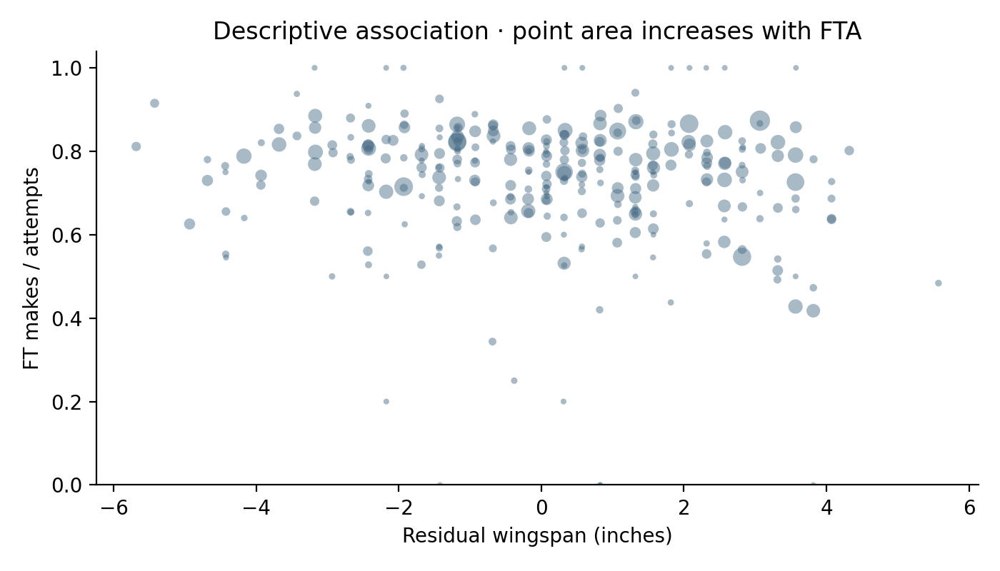
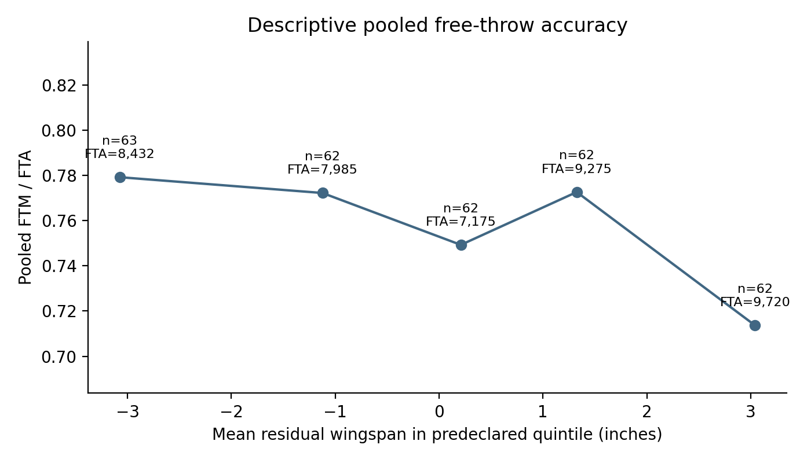
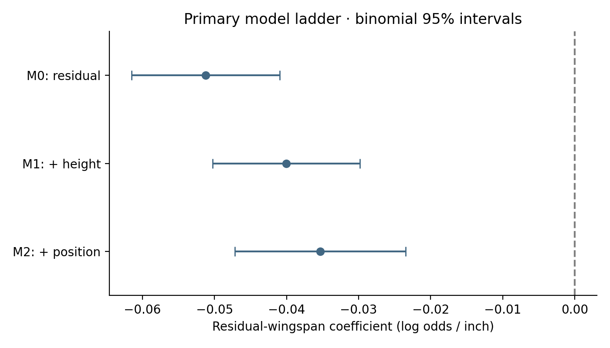
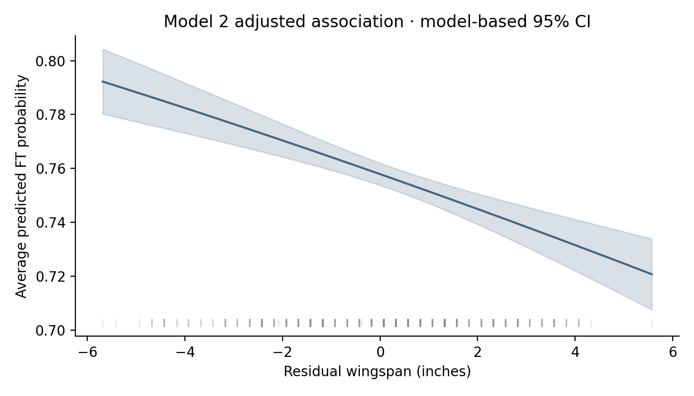

# Stage 1 — 2013-14 FT × residual wingspan

## 1. Objective
Estimate the association between relative wingspan and free-throw accuracy in the validated single-season candidate population.

This analysis estimates associations within NBA players with available combine measurements. It does not identify a causal effect of arm length on shooting, because combine participation, NBA selection, role assignment and other factors may jointly affect the observed sample.

## 2. Frozen protocol
The Stage 0C PASS released the Stage 0B candidate for inference. Exact candidate and reference SHA-256 checks passed before loading outcomes. [Analysis plan](stage1_evidence/analysis_plan.json) records decisions before fitting: grouped-binomial logit; residual wingspan primary; M0 → M1 → M2; original positions; C reference; unscaled model-based Wald inference. FTA is the binomial denominator, never an additional predictor. No exposure or threshold was selected from its p-value. Secondary analyses cannot replace the primary result.

## 3. Analysis population
311 players remain in accounting; 299 with FTA>0 contribute 42,587 attempts. Twelve zero-attempt players remain in the saved analysis dataset with undefined FT%. Primary fitting has no minimum FTA threshold. Exact IDs, measurements, years, and original membership are unchanged. Model 3: **not run — prerequisite not validated**. Stage 0B provenance does not provide independently validated age/experience; none was fetched.

## 4. Residual-wingspan construction
OLS in the frozen 960-person reference gives wingspan = **4.574910521 + 1.001341005 × barefoot height**, in inches; R²=0.704151892. Reference residual mean=-3.03e-15, sample SD=2.262717 inches. Only height and wingspan enter this geometric transformation. No shooting, NBA survival, position, or post-2013 measurements enter it.

The residual-height correlation in the 311-player candidate sample is **0.055057**, not assumed zero. Candidate residual SD=2.176467 inches. Inference below conditions on this geometric fit and does not propagate reference-fit uncertainty.

## 5. Sample characteristics
Table 1. Anthropometric descriptions, calculated before shooting fits. SD uses ddof=1; quartiles use linear interpolation.

| measure | count | mean | std | min | 25% | 50% | 75% | max |
| --- | --- | --- | --- | --- | --- | --- | --- | --- |
| height_wo_shoes_inches | 311 | 77.728 | 3.3955 | 67.75 | 75.5 | 78 | 80.25 | 85.25 |
| wingspan_inches | 311 | 82.473 | 4.1367 | 70.75 | 79.5 | 83 | 85.5 | 92.5 |
| residual_wingspan | 311 | 0.065711 | 2.1765 | -5.6859 | -1.433 | 0.31077 | 1.57 | 5.5718 |
| wingspan_advantage | 311 | 4.7449 | 2.1767 | -1 | 3.25 | 5 | 6.25 | 10.25 |
| wingspan_ratio | 311 | 1.0611 | 0.027814 | 0.98792 | 1.0408 | 1.0631 | 1.0806 | 1.1331 |

Original position counts appear in Table 4. Separately, FTA median=89, Q1=29.5, Q3=196; 203 players have FTA≥50 and 145 have FTA≥100. [Shooting distribution](stage1_evidence/shooting_descriptive.csv) gives FTM/FTA counts and individual FT% distribution among positive-attempt players; no average individual percentage is used as an accuracy estimate.



## 6. Descriptive association
The scatter has point area increasing with attempts and no unweighted regression line. Quintile cutpoints were computed from all 311 residuals, before fitting or plotting the shooting relationship, using linear interpolation. Exact edges are in [bin_cutpoints.json](stage1_evidence/bin_cutpoints.json). Bins retain zero-attempt players in n; rates are pooled FTM / pooled FTA.



| residual_wingspan | n | total_fta | total_ftm | mean_residual | pooled_ft_pct |
| --- | --- | --- | --- | --- | --- |
| (-5.687, -1.92] | 63 | 8432 | 6570 | -3.0742 | 0.77917 |
| (-1.92, -0.426] | 62 | 7985 | 6166 | -1.1227 | 0.7722 |
| (-0.426, 0.584] | 62 | 7175 | 5376 | 0.20929 | 0.74927 |
| (0.584, 2.077] | 62 | 9275 | 7166 | 1.3251 | 0.77261 |
| (2.077, 5.572] | 62 | 9720 | 6937 | 3.0417 | 0.71368 |



These are descriptive summaries, with heterogeneous roles and shooting opportunity within each bin.

## 7. Model 0
Grouped-binomial logit(p)=intercept + residual_wingspan. Table 2 reports the primary ladder; coefficient and OR scales are per inch, with conventional binomial 95% intervals. All models use 299 players and 42,587 attempts.

| model | beta | se | ci_low | ci_high | odds_ratio | or_low | or_high | p | or_per_sd |
| --- | --- | --- | --- | --- | --- | --- | --- | --- | --- |
| M0 | -0.051244 | 0.0052404 | -0.061515 | -0.040973 | 0.95005 | 0.94034 | 0.95985 | 1.39e-22 | 0.89446 |
| M1 | -0.040048 | 0.0052157 | -0.05027 | -0.029825 | 0.96074 | 0.95097 | 0.97061 | 1.6108e-14 | 0.91653 |
| M2 | -0.03531 | 0.0060478 | -0.047163 | -0.023456 | 0.96531 | 0.95393 | 0.97682 | 5.2686e-09 | 0.92603 |

M0 estimates a negative pooled association. OR per SD uses the fixed 311-person residual SD. These p-values are conditional on binomial variance and are not robust to the substantial overdispersion below.

## 8. Model 1
Adds barefoot height. The residual coefficient changes from -0.051244 to -0.040048, a 21.8% reduction in magnitude. The direction remains negative. Orthogonality in the 960-person geometric reference does not imply orthogonality in this selected analysis population or in an attempt-weighted logistic likelihood.

## 9. Model 2
Adds original combine-position indicators, preserving all hybrids; blank/missing is unknown. C is the alphabetically first reference category. Residual coefficient=-0.035310, OR=0.965306 per inch. **The conventional 95% coefficient interval [-0.047163, -0.023456] excludes zero**; the OR interval excludes one.

All seven primary/secondary fits converge with full-rank designs and finite covariance. Mixed-success/failure observations span each design, ruling out complete or quasi separation. Fitted probabilities are not near numerical boundaries. Full coefficient and covariance matrices, player-level leverage/Pearson/Cook diagnostics, and model fit records are saved.

| model | n | total_fta | log_likelihood | deviance | aic | dispersion | min_probability | max_probability | max_hat |
| --- | --- | --- | --- | --- | --- | --- | --- | --- | --- |
| M0 | 299 | 42587 | -1750.1 | 2195.5 | 3504.3 | 7.6181 | 0.7032 | 0.80838 | 0.052478 |
| M1 | 299 | 42587 | -1554 | 1803.3 | 3114.1 | 6.1684 | 0.63595 | 0.86404 | 0.0692 |
| M2 | 299 | 42587 | -1423 | 1541.3 | 2878.1 | 5.5616 | 0.55618 | 0.9403 | 1 |
| wingspan_advantage | 299 | 42587 | -1423 | 1541.3 | 2878.1 | 5.5616 | 0.55618 | 0.9403 | 1 |
| wingspan_ratio | 299 | 42587 | -1424 | 1543.2 | 2880 | 5.5695 | 0.55747 | 0.9403 | 1 |
| FTA50 | 203 | 40640 | -1167.4 | 1288.4 | 2366.8 | 6.9918 | 0.544 | 0.9403 | 1 |
| FTA100 | 145 | 36445 | -944.96 | 1096.2 | 1919.9 | 8.5571 | 0.57648 | 0.86802 | 0.53896 |

The unknown category contains Danny Granger alone (63/67). Its M2 leverage is essentially one; its deletion diagnostic is undefined because deleting the only member removes that estimable category. The finite singleton estimate is retained under the predeclared policy, not merged. It is not a separation failure, but position-specific interpretation is fragile. There are 42 M2 observations above 2p/n leverage. Raw uncentered design condition number is approximately 5,228; units and intercept contribute to this value, while rank and covariance remain finite. No position-policy change was made. Inspect [M2 influence](stage1_evidence/M2_influence.csv) before treating any one-player result as stable.

## 10. Position adjustment / Simpson's paradox question
M0→M2 reduces the negative coefficient magnitude by **31.1%**, with no sign reversal; M1→M2 adds 11.8% attenuation. M0→M2 includes both height and position adjustments, so its full change cannot be assigned solely to position. This is compatible with role/height structure in the pooled association, not proof of a causal mechanism; logistic noncollapsibility also limits a pure confounding interpretation. There is no observed Simpson sign reversal in this ladder.

Table 4. Original positions; pooled rates use summed makes and attempts. No separate tiny-category regressions were fitted.

| position | n | mean_residual | median_residual | total_fta | total_ftm | pooled_ft_pct |
| --- | --- | --- | --- | --- | --- | --- |
| C | 16 | 1.1735 | 1.1903 | 1960 | 1166 | 0.5949 |
| C-PF | 8 | -1.4045 | -1.3107 | 679 | 454 | 0.66863 |
| PF | 55 | 0.60049 | 0.31915 | 8072 | 5813 | 0.72014 |
| PF-C | 17 | 0.74185 | 1.5648 | 3139 | 2164 | 0.68939 |
| PF-SF | 16 | 0.56817 | 0.94281 | 1723 | 1238 | 0.71851 |
| PG | 55 | -0.4224 | -0.17113 | 7941 | 6400 | 0.80594 |
| PG-SG | 15 | -0.64215 | -0.42582 | 1947 | 1604 | 0.82383 |
| SF | 40 | -0.22786 | -0.054509 | 5533 | 4334 | 0.7833 |
| SF-PF | 14 | 1.0147 | 1.1931 | 1813 | 1484 | 0.81853 |
| SF-SG | 15 | -0.62922 | 0.071162 | 1548 | 1156 | 0.74677 |
| SG | 33 | -0.11595 | 0.075185 | 4224 | 3328 | 0.78788 |
| SG-PG | 10 | -1.0258 | -1.051 | 1368 | 1086 | 0.79386 |
| SG-SF | 16 | 0.50893 | 0.44666 | 2573 | 1925 | 0.74815 |
| unknown | 1 | 1.3185 | 1.3185 | 67 | 63 | 0.9403 |



## 11. Marginal probability interpretation
Set residual wingspan to Q25=-1.433029 or Q75=1.569988 inches, defined in all 311 candidates. Preserve each of the 299 likelihood players' observed height and position, then average predicted probabilities equally across players. Predicted FT probability is 76.690629% at Q25 and 74.778213% at Q75. Q75−Q25 is **-1.912 percentage points**, model-based 95% CI [-2.553, -1.272]. The paired delta-method contrast uses the full covariance matrix.

This is an association-based model contrast, not a causal treatment effect. Some synthetic residual/height/position combinations are sparsely supported. The curve spans the observed residual range; its pointwise delta-method bands condition on the model and omit extra-binomial variance and geometric-fit uncertainty.



## 12. Alternate exposure sensitivity
Table 3a. Secondary M2 structure; ratio coefficients below are per 1.0 ratio unit.

| model | beta | ci_low | ci_high | odds_ratio | p |
| --- | --- | --- | --- | --- | --- |
| wingspan_advantage | -0.03531 | -0.047163 | -0.023456 | 0.96531 | 5.2686e-09 |
| wingspan_ratio | -2.6854 | -3.6126 | -1.7582 | 0.068195 | 1.3744e-08 |

Advantage remains negative. With height and intercept included, advantage and residual wingspan are exact linear reparameterizations: their identical exposure coefficient and likelihood are expected algebraically, not independent corroboration. Ratio per **0.01** increase gives beta=-0.026854, CI [-0.036126, -0.017582], OR=0.973503, OR CI [0.964519, 0.982572]. Direction remains negative. Residual wingspan remains primary.

## 13. FTA-threshold sensitivity
Table 3b. Secondary M2 residual-wingspan fits.

| threshold | n | total_fta | beta | ci_low | ci_high | odds_ratio |
| --- | --- | --- | --- | --- | --- | --- |
| 50 | 203 | 40640 | -0.038912 | -0.05127 | -0.026554 | 0.96184 |
| 100 | 145 | 36445 | -0.038626 | -0.051815 | -0.025436 | 0.96211 |

Both estimates remain negative and slightly larger in magnitude than primary M2. At FTA≥100, unknown has no observations and its indicator is not estimable or included; all observed original categories remain distinct and C remains reference. This is an absent level, not a merged category. Thresholds alter the target sample and do not resolve overdispersion.

## 14. Overdispersion diagnostic
Predeclared Pearson chi-square / residual degrees of freedom >1.5 flags substantial overdispersion. M0=7.618, M1=6.168, **M2=5.562** (1573.924/283). Every sensitivity also exceeds the threshold. The frozen binomial likelihood remains primary, but conventional SEs/intervals and small p-values can substantially overstate precision when remaining player heterogeneity violates binomial variance. The excluded-zero interval alone is not robust evidence against a population null under a more adequate variance model. No new model family was fitted opportunistically.

## 15. Selection-coverage limitation
Reuse the approved Stage 0B positive-minute coverage summary; no FT accuracy comparison is introduced here.

| group | players | median_minutes | mean_minutes | median_games | mean_games | players_with_any_box_position | box_position_labeled_game_fraction |
| --- | --- | --- | --- | --- | --- | --- | --- |
| measured | 311 | 1338.8 | 1347.3 | 63 | 55.315 | 241 | 0.51369 |
| unmeasured | 171 | 971.02 | 1030.4 | 55 | 49.175 | 115 | 0.41182 |

Only 311/482 (64.5%) positive-minute players have usable measurements; 171 do not. Measured players have higher median minutes (1338.77 versus 971.02) and games (63 versus 55). Box-position availability is incomplete and not equivalent to validated combine role. Selection into the combine, NBA, measured sample, and shooting opportunities limits generalizability. This analysis does not correct selection bias.

## 16. Main scientific result
The estimated association is negative throughout the primary ladder and attenuates after adjustment. M2 estimates about 3.47% lower FT odds per additional residual inch and a 1.91-percentage-point lower adjusted predicted probability from Q25 to Q75. Its conventional interval excludes zero, but substantial overdispersion means uncertainty requires further robustness analysis before stronger inferential conclusions.

## 17. What the analysis does NOT establish
This analysis estimates associations within NBA players with available combine measurements. It does not identify a causal effect of arm length on shooting, because combine participation, NBA selection, role assignment and other factors may jointly affect the observed sample.

The analysis does not establish a biomechanical mechanism, a population-wide association for all NBA players, or a result that generalizes across seasons. It does not distinguish all role-related selection and unmeasured confounding.

## 18. Limitations
Single season; combine availability and NBA survival selection; historical combine position may differ from current role; small hybrid groups and one unknown; incomplete uniform validation of role, age and experience; unmeasured skill and training; unequal shooting opportunity; conventional binomial variance poorly fits remaining heterogeneity; linear log-odds form; conditional geometric transformation; marginal extrapolation; unresolved prior cross-source identity links remain unapplied. Influence outputs are diagnostic only: no outcome-driven player exclusion or refit was performed.

## 19. Reproducibility
Run from this subproject:

```sh
python3 -m venv .venv-stage1
.venv-stage1/bin/pip install -r requirements-stage1.txt
.venv-stage1/bin/pip check
MPLCONFIGDIR=/private/tmp/stage1-mpl .venv-stage1/bin/python scripts/stage1_analysis.py
.venv-stage1/bin/python scripts/stage1_report.py
.venv-stage1/bin/python -m unittest discover -s tests -p test_stage1.py -v
```

Isolated Python 3.10 environment; statsmodels 0.14.5, numpy 2.2.6, scipy 1.15.3, pandas 2.2.3, matplotlib 3.10.3 and pyarrow 21.0.0; all installed dependencies are pinned in requirements-stage1.txt. pip check passes. [Statsmodels GLM documentation](https://www.statsmodels.org/v0.14.4/generated/statsmodels.genmod.generalized_linear_model.GLM.html) documents the two-column successes/failures response used here. Model code supplies [FTM, FTA−FTM] without frequency weights. No other project's environment changed.

[Primary result](stage1_evidence/primary_result.json) was written before this report or interpretation. It freezes model estimates, hashes and marginal contrast; reruns assert exact equality before continuing. Initial implementation checks corrected a syntax typo and the blank-string representation of missing position before the first successful ladder; no formula or exposure was changed. [Build manifest](stage1_evidence/build_manifest.json) records inputs, environment, scripts and outputs. [Tests](stage1_evidence/test_run.txt) cover A–R plus denominator and integrity checks. Arrow CPU-cache discovery warnings under sandboxing do not prevent verified Parquet round trips.

Candidate hash: `4656da551e99fc7a8fc26d6f7847f956134a9da15ed47ccd13bbf0f982fbf735`. Reference hash: `14537d9c1cec20b388fc2cf5c86d7ea9ec2e435117c62da499f2b2fa2820d85a`. Analysis hash: `47ce0a925e0251f4714b6666cef5b46eaa508dc7e03a7fb5e8e6bcb5dda8d652`. Numerical code hash: `21f85586bc6347a562b3ff2a3a43e3e1c9d1be0e5e231a406a252e3df45f4bf1`. Analysis Parquet remains local and ignored. Prior-stage data, code and evidence are preserved.

## 20. Stage 1 exit criteria
Execution PASS is contingent on the saved test summary passing: frozen inputs verified; correct reference-only residualization; grouped-count outcome; exact primary ladder; result frozen before interpretation; no outcome-driven selection; secondary analyses labeled; position question addressed; dispersion and coverage reported; fixed-environment rerun reproduces primary estimates. Scientific significance is not an execution criterion. Tests and the build receipt provide the final verification record.

## 21. Recommended next step
Review this single-season prototype, especially overdispersion and leverage. A separately authorized robustness stage should assess beta-binomial, quasi-binomial or hierarchical logistic uncertainty and influence sensitivity under a documented protocol. **No Stage 2, multi-season model, hierarchical model, C&S or pull-up expansion was run. No commit or push was made.**
