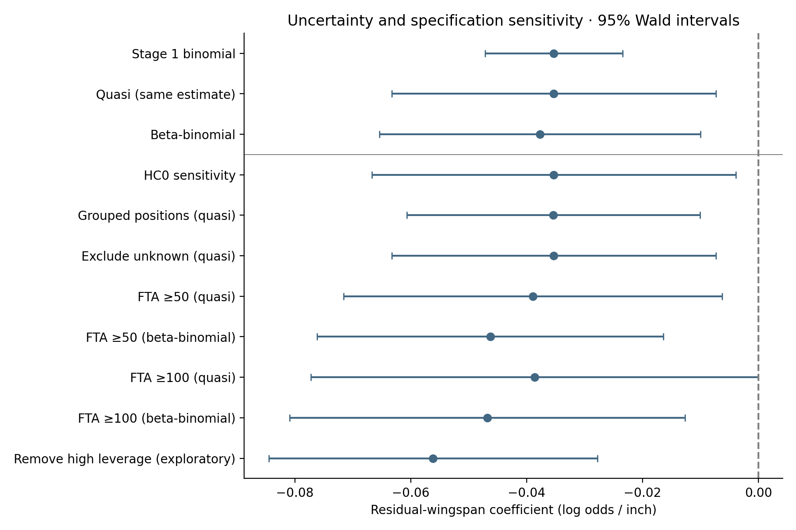
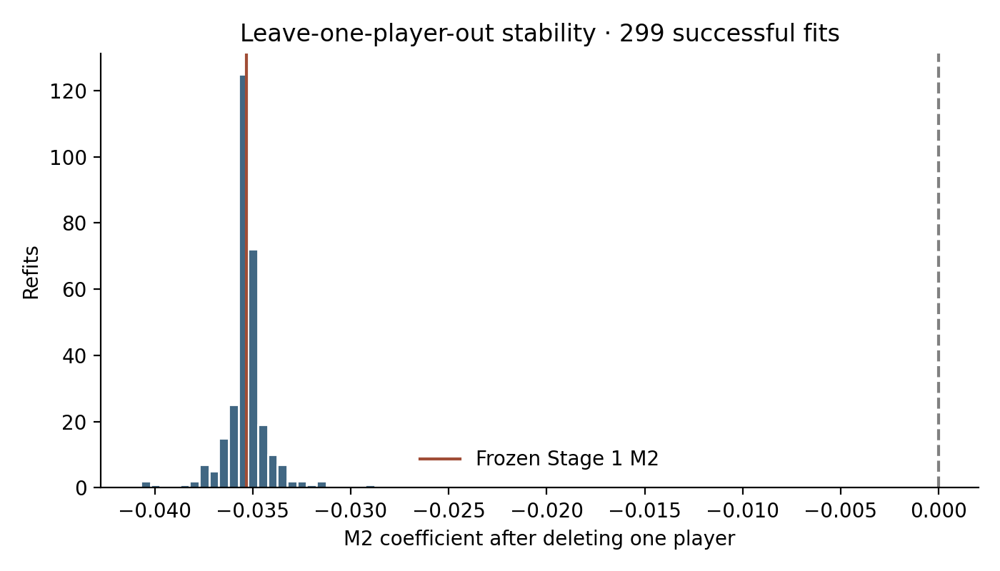
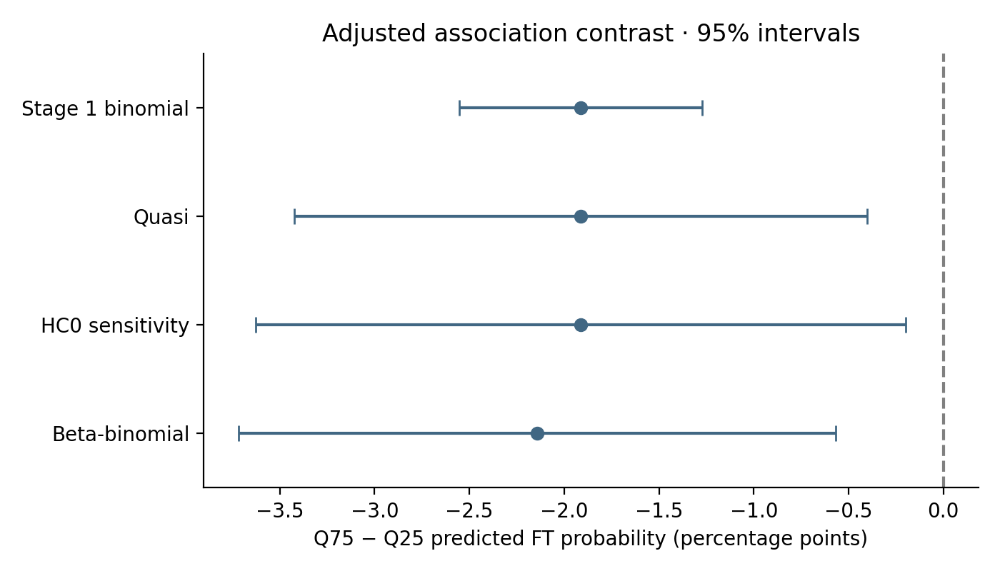

# Stage 2 — Robust inference for residual wingspan × FT accuracy

## 1. Objective
Assess uncertainty and influence robustness of the frozen single-season M2 association without changing the scientific question, primary exposure, or primary population. This is a robustness stage, not a search for a favorable p-value.

This analysis estimates associations within NBA players with available combine measurements. It does not identify a causal effect of arm length on shooting, because combine participation, NBA selection, role assignment and other factors may jointly affect the observed sample.

## 2. Why Stage 2 was needed
Stage 1 M2 Pearson dispersion was 5.561570 (M0 7.618; M1 6.168), well above binomial variance. Conventional coefficient uncertainty was therefore too narrow if the systematic component did not explain player heterogeneity. Stage 2 separates point-estimate stability from uncertainty width.

## 3. Frozen Stage 1 result
Stage 1 M2 beta=-0.035309852 per inch, OR=0.965306, conventional 95% CI [-0.047163, -0.023456]. Exact frozen data: 311 accounting players, 299 FTA>0 likelihood players, 42,587 attempts. Twelve zero-attempt players remain in accounting. The saved residual is read directly; the 960-person reference is neither modified nor refitted.

All Stage 1 artifacts and other pre-existing project files are protected by a SHA-256 preservation manifest. Primary adjustment remains intercept + residual wingspan + barefoot height + original combine positions, including distinct hybrids and unknown, reference C. No new confounder is added. [Predeclared analysis plan](stage2_evidence/analysis_plan.json) fixes variance methods, grouping, sensitivity rules and interpretation criteria.

## 4. Quasi-binomial result
Keep beta unchanged and multiply the original full covariance by phi=Pearson chi-square / residual df =1573.924290/283=5.561570. Scaled SE=0.014263, normal-Wald CI [-0.063264, -0.007356], OR CI [0.938696, 0.992671], p=0.013297. The interval excludes zero. This is an uncertainty correction, not an independent point-estimate fit. Normal rather than t inference was declared before fitting; phi estimation uncertainty is not separately propagated.

## 5. Beta-binomial result
The documented likelihood is log choose(n,y) + log B(y+mu*kappa,n−y+(1−mu)*kappa) − log B(mu*kappa,(1−mu)*kappa), where mu=expit(X beta). One common kappa>0 is estimated jointly with all regression coefficients; rho=1/(1+kappa). Each player contributes one grouped-count likelihood term, including the combinatorial constant.

Beta=-0.037706514, SE=0.014141, 95% CI [-0.065423, -0.009990], OR=0.962996, OR CI [0.936671, 0.990060], p=0.007667. The coefficient interval excludes zero. Estimated kappa=32.448727, rho=0.029897. Log likelihood=-1021.329489; AIC=2076.658978, counting 16 mean coefficients plus one precision parameter. Converged from all three predeclared starts; positive observed information and stable Hessian step checks passed.

The pinned statsmodels GLM family interface does not provide this beta-binomial regression. A small custom regression wrapper uses SciPy's standard L-BFGS-B optimizer, an analytic digamma score, and central differences of that score for the observed information. The full joint information is inverted before extracting coefficient covariance, accounting for precision estimation. Internal centering/scaling is an invertible numerical reparameterization; estimates/covariance are transformed back to original units. No custom optimizer was written. [SciPy's documented PMF](https://docs.scipy.org/doc/scipy-1.15.3/reference/generated/scipy.stats.betabinom.html) supplies an independent numerical reference.

## 6. Comparison of point estimates
Primary quasi and HC0 retain Stage 1 beta exactly. Beta-binomial moves magnitude by 6.79% and remains negative. It estimates a distribution of latent player probabilities and changes the relative information contributed by high-attempt players, so identical coefficients are not required.

| model | beta | se | ci_low | ci_high | odds_ratio | or_low | or_high | dispersion_or_overdispersion | n | FTA | converged |
| --- | --- | --- | --- | --- | --- | --- | --- | --- | --- | --- | --- |
| Stage1_binomial_M2 | -0.0353099 | 0.0060478 | -0.0471633 | -0.0234564 | 0.965306 | 0.953932 | 0.976817 | 1 | 299 | 42587 | True |
| quasi_binomial_M2 | -0.0353099 | 0.0142625 | -0.0632639 | -0.00735581 | 0.965306 | 0.938696 | 0.992671 | 5.56157 | 299 | 42587 | True |
| beta_binomial_M2 | -0.0377065 | 0.0141415 | -0.0654233 | -0.00998972 | 0.962996 | 0.936671 | 0.99006 | 0.0298965 | 299 | 42587 | True |
| HC0_M2_sensitivity | -0.0353099 | 0.0160108 | -0.0666905 | -0.0039292 | 0.965306 | 0.935485 | 0.996079 | nan | 299 | 42587 | True |
| grouped_position_sensitivity | -0.0353952 | 0.0129062 | -0.0606909 | -0.0100996 | 0.965224 | 0.941114 | 0.989951 | 5.92744 | 299 | 42587 | True |
| exclude_unknown_sensitivity | -0.0353099 | 0.0142625 | -0.0632639 | -0.00735581 | 0.965306 | 0.938696 | 0.992671 | 5.56157 | 298 | 42520 | True |
| FTA50_robust | -0.038912 | 0.0166724 | -0.0715894 | -0.0062347 | 0.961835 | 0.930913 | 0.993785 | 6.99183 | 203 | 40640 | True |
| FTA50_beta_binomial | -0.0462747 | 0.0152424 | -0.0761492 | -0.0164002 | 0.95478 | 0.926678 | 0.983734 | 0.0263277 | 203 | 40640 | True |
| FTA100_robust | -0.0386257 | 0.0196853 | -0.0772082 | -4.32889e-05 | 0.962111 | 0.925697 | 0.999957 | 8.55712 | 145 | 36445 | True |
| FTA100_beta_binomial | -0.0467784 | 0.0174107 | -0.0809027 | -0.012654 | 0.954299 | 0.922283 | 0.987426 | 0.0253694 | 145 | 36445 | True |
| high_leverage_group_removal_exploratory | -0.0561351 | 0.0144624 | -0.0844809 | -0.0277892 | 0.945411 | 0.918989 | 0.972593 | 3.86651 | 257 | 28127 | True |

Dispersion column means phi for quasi rows, rho for beta-binomial rows, fixed binomial scale=1 for Stage 1, and unavailable/not applicable for HC0. These parameters are not interchangeable. Binomial M2 AIC=2878.091 and beta-binomial AIC=2076.659 use the same 299 grouped outcomes and full count likelihood constants, so those two likelihood criteria are comparable. Quasi has no normalized probability likelihood/AIC. AICs across different FTA subsets must not be ranked; no model was chosen by p-value or AIC.

## 7. Comparison of uncertainty
Relative to Stage 1, coefficient SE/interval width is **2.358× quasi**, **2.338× beta-binomial**, and **2.647× HC0**. Point estimates remain similar while uncertainty grows substantially. All three major intervals exclude zero under their respective assumptions; that is descriptive evidence, not the stage execution criterion.

HC0 uses one score s_i=X_i(FTM_i−FTA_i*p_i) per player and sandwich B(sum s_i s_iᵀ)B, with B the inverse binomial information. It matches statsmodels HC0 numerically. This is meaningful under independent players and a correct conditional mean, without pretending the attempts are independent score rows. It adds no invented cluster structure. HC0 can understate uncertainty under high leverage; a singleton indicator has no replication to estimate its own robust variation. HC2/HC3 were not forced at leverage one. HC0 is a sensitivity, not the sole evidentiary basis.



## 8. Overdispersion interpretation
Quasi uses one constant multiplier. Beta-binomial variance is n*mu*(1−mu)*[1+(n−1)*rho]; inflation depends on attempt count. At n=100, fitted rho implies inflation 3.960; at n=500 it is 15.918. Rho represents latent extra-binomial heterogeneity under this model, not evidence of a particular behavioral mechanism. A common rho is an assumption, and robust variance does not repair omitted covariates or selection.

## 9. Leave-one-out stability
All **299/299** exact M2 deletion refits succeeded; failed fits=0, sign reversals=0. Beta range [-0.040705680, -0.028763948], median=-0.035306980, Q1=-0.035568483, Q3=-0.035067644. Each refit removes exactly one ID and preserves saved residuals and original observed position labels. When the singleton is removed, only its all-zero indicator is omitted; no categories are merged. LOO diagnoses the frozen binomial point-estimate influence; it is not a beta-binomial jackknife or a new exclusion rule.

| removed_name | beta | n | FTA |
| --- | --- | --- | --- |
| Dwight Howard | -0.0287639 | 298 | 41949 |
| Anthony Davis | -0.0407057 | 298 | 42147 |



## 10. Singleton unknown-position sensitivity
Excluding Danny Granger only is secondary: n=298, attempts=42,520, beta=-0.035309852, quasi CI [-0.063264, -0.007356]. The shared slope and scaled uncertainty are effectively unchanged. His dedicated intercept can fit his observed probability without constraining the common slope; removing both that row and its indicator leaves residual df unchanged. This explains the numerical equivalence; it does not validate inference about unknown-position players generally.

The separately predeclared exploratory group removal uses Stage 1 hat>2p/n =32/299≈0.1070. It removes 42 players, leaving **257 and 28,127 attempts**, beta=-0.056135, quasi CI [-0.084481, -0.027789]. Magnitude increases **59.0%**, crossing the predeclared 50% materiality rule, with no reversal. This simultaneously removes 34.0% of attempts and changes population/role support; it is not a justified replacement sample. The primary model retains every valid FTA>0 player.

## 11. Position-grouping sensitivity
The outcome-independent map was frozen before refitting: Guard=PG, SG, PG-SG, SG-PG; Wing=SF, SG-SF, SF-SG, PF-SF, SF-PF; Big=PF, C, C-PF, PF-C; Unknown=unknown. All original labels are covered. Alphabetical Big is reference for this secondary model only.

Grouped-position beta=-0.035395218, quasi CI [-0.060691, -0.010100]. Its magnitude and direction are very close to original-position M2. Primary robustness fits retain the original categories.

## 12. Alternate exposure robustness
Both frozen alternates receive quasi and beta-binomial fits; neither can replace residual wingspan. Raw ratio coefficients in the evidence are per full ratio unit.

| model | beta | ci_low | ci_high | odds_ratio |
| --- | --- | --- | --- | --- |
| quasi_wingspan_advantage | -0.0353099 | -0.0632639 | -0.00735581 | 0.965306 |
| BB_wingspan_advantage | -0.0377065 | -0.0654233 | -0.00998973 | 0.962996 |

Advantage and residual are algebraically equivalent given height and intercept; the tiny beta-binomial numerical difference is optimization tolerance, not independent replication. For interpretability, ratio below is per **0.01** ratio increase:

| model | beta | ci_low | ci_high | odds_ratio | or_low | or_high |
| --- | --- | --- | --- | --- | --- | --- |
| quasi_wingspan_ratio | -0.0268539 | -0.0487354 | -0.00497236 | 0.973503 | 0.952433 | 0.99504 |
| BB_wingspan_ratio | -0.0284688 | -0.0502121 | -0.00672554 | 0.971933 | 0.951028 | 0.993297 |

All estimates remain negative; these robust intervals exclude zero under the specified variance models. This is qualitative consistency, not multiple independent primary confirmations.

## 13. FTA-threshold robustness
The only thresholds are the previously frozen 50 and 100 attempts. Both quasi and beta-binomial versions retain M2 adjustment among observed categories. Unknown is absent at FTA≥100 and its empty indicator is omitted; no level is merged.

| model | n | FTA | beta | ci_low | ci_high | odds_ratio |
| --- | --- | --- | --- | --- | --- | --- |
| FTA50_robust | 203 | 40640 | -0.038912 | -0.0715894 | -0.0062347 | 0.961835 |
| FTA50_beta_binomial | 203 | 40640 | -0.0462747 | -0.0761492 | -0.0164002 | 0.95478 |
| FTA100_robust | 145 | 36445 | -0.0386257 | -0.0772082 | -4.32889e-05 | 0.962111 |
| FTA100_beta_binomial | 145 | 36445 | -0.0467784 | -0.0809027 | -0.012654 | 0.954299 |

All point estimates are negative. The FTA≥100 quasi upper bound is −0.0000433, effectively at zero for practical interpretation; its p≈0.04974 should not be presented as qualitatively different from 0.05. These are population sensitivities, not grounds to select a threshold.

## 14. Robust probability contrast
Reuse Q25=−1.433029 and Q75=1.569988 inches from the full 311-player residual distribution. Average equally over the same 299 observed heights/positions, substituting only residual wingspan. The paired delta method uses the full appropriate mean-coefficient covariance. Beta-binomial predicts mean mu, not a simulated latent individual probability.

| method | difference_pp | CI_low_pp | CI_high_pp |
| --- | --- | --- | --- |
| Stage1_binomial | -1.91242 | -2.55285 | -1.27198 |
| quasi | -1.91242 | -3.42275 | -0.40208 |
| HC0 | -1.91242 | -3.62752 | -0.197312 |
| beta_binomial | -2.14244 | -3.71632 | -0.568556 |

Preferred beta-binomial contrast is **-2.142 percentage points** (95% CI -3.716 to -0.569). Quasi retains the Stage 1 −1.912-point contrast with widened uncertainty. These are adjusted association contrasts, not causal effects; synthetic covariate combinations and reference-fit uncertainty remain limitations.



## 15. Scientific interpretation
Under the predeclared operational rule, classification is **UNCERTAIN DIRECTION**, driven by **magnitude sensitivity to joint high-leverage removal**, not an observed sign reversal or a major robust interval crossing zero. Direction is consistently negative across all tested models and every individual deletion; quasi/beta-binomial/HC0 uncertainty is roughly 2.3–2.6 times the original. Removing 42 players together increases magnitude by 59%, so the strict “strong directional robustness” category is not awarded under the frozen criterion. This wording should not obscure that sign stability is stronger than magnitude stability.

The evidence supports a carefully protocolized multi-season/hierarchical follow-up to assess generalizability and player heterogeneity, but does not require it or settle the association. No such analysis has started. Execution success does not depend on this classification or a p-value.

## 16. What remains unresolved
Conditional mean misspecification; heterogeneous dispersion across roles or attempt volumes; player dependence not represented by an invented cluster; small categories and singleton uncertainty; asymptotic Wald intervals rather than profile/bootstrap intervals; informative shooting opportunity; sensitivity to joint influence; residualization uncertainty held fixed; historical combine role versus current role; age/experience remain unvalidated and absent. Beta-binomial modeling addresses one form of extra-binomial variation, not these other issues.

## 17. Selection-bias limitation
Measurement coverage remains 311/482 positive-minute players; 171 are unmeasured. Previously approved median minutes were 1338.77 measured versus 971.02 unmeasured; median games 63 versus 55. Combine participation, NBA selection and measurement availability remain the largest generalizability limitation. No FT-accuracy-based selection comparison or correction is introduced.

This analysis estimates associations within NBA players with available combine measurements. It does not identify a causal effect of arm length on shooting, because combine participation, NBA selection, role assignment and other factors may jointly affect the observed sample.

## 18. Reproducibility
Reuse the isolated Stage 1 environment and pinned requirements-stage1.txt; no dependencies or earlier artifacts were changed. Python 3.10, statsmodels 0.14.5 and SciPy 1.15.3. From this subproject:

```sh
.venv-stage1/bin/python scripts/stage2_validation.py
.venv-stage1/bin/python scripts/stage2_analysis.py
MPLCONFIGDIR=/private/tmp/stage2-mpl .venv-stage1/bin/python scripts/stage2_report.py
.venv-stage1/bin/python scripts/verify_stage2.py
```

Validation compares the full PMF with SciPy (max log-probability error 8.9e-16) and independent beta-mixture quadrature (error 1.4e-14), verifies the binomial limit, increasing variance, invalid-count rejection, analytic score derivatives, three-start convergence and Hessian step stability. Seed 20260928 simulates 5,000 players; all known coefficients and precision recover within four estimated SEs. Forced maxiter=0 failures are rejected rather than hidden. These checks support implementation validity, not truth of the model assumptions.

[Primary robustness result](stage2_evidence/primary_robustness_result.json) was persisted before narrative interpretation and must reproduce exactly on rerun. An initial exploratory high-leverage mask used CSV integer IDs against Parquet string IDs and removed zero players. Before narrative writing, this was corrected with explicit string normalization and a 42-removal assertion. The invalid first artifact is retained with an [implementation correction record](stage2_evidence/implementation_correction.md); all unaffected results are verified identical. No statistical formula, grouping, threshold or interpretation rule changed.

[Build manifest](stage2_evidence/build_manifest.json), [test log](stage2_evidence/test_run.txt), numerical validation and the preservation manifest provide the verification record. Figures are matplotlib; no dashboard or new exposure-outcome exploration was added. Source code and full coefficient covariance, optimizer diagnostics, all LOO results and secondary tables are retained.

## 19. Stage 2 exit criteria
Execution PASS requires verified frozen inputs/results, transparent Pearson scaling, validated beta-binomial, all 299 recorded influence fits, predeclared grouping and threshold sensitivities, no outcome-driven primary exclusions, numerical result freeze preceding narrative, passing tests and deterministic rerun. The verification script records these outcomes. The scientific classification is independent of execution success.

## 20. Recommended next step
Review the dispersion model and the 59% joint-influence magnitude change before any expansion. If authorized later, predeclare a multi-season/hierarchical protocol with explicit selection/role limitations, variance checks and influence reporting. The current result is sufficient motivation for that follow-up, not a causal or broadly generalizable conclusion. **No Stage 3, multi-season/hierarchical longitudinal model, shot-context data, new confounder, commit or push was performed.**
