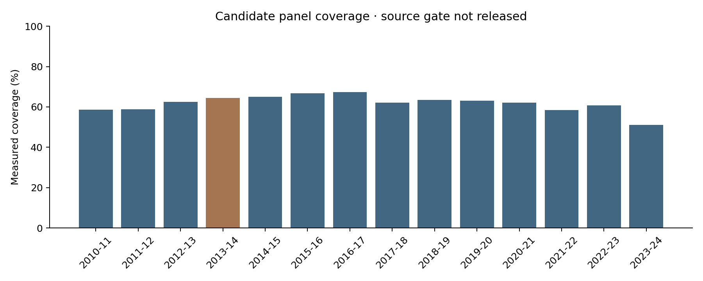

# Stage 3 — Multi-season hierarchical FT replication: Part A status

**Stage 3 execution: BLOCKED AT THE SOURCE-VALIDATION GATE. Part B was not started.** The candidate panel is saved and hashed for audit, but is not released for inference. No hierarchical estimate, posterior, replication conclusion or sensitivity-model result exists.

## 1. Objective
Test longitudinal generalization only after validating the broader source and freezing eligibility.

This analysis estimates associations within NBA players with available combine measurements. It does not identify a causal effect of arm length on shooting, because combine participation, NBA selection, role assignment and other factors may jointly affect the observed sample.

## 2. Why multi-season analysis is needed
Stages 1–2 used 2013–14 for model development, uncertainty and influence analysis. Repeated observations, season differences, persistent player heterogeneity and extra-binomial variation need a longitudinal model. That scientific step remains pending rather than bypassing a failed provenance check.

## 3. Development vs replication distinction
The primary candidate excludes 2013–14. Available archive seasons were rebuilt, not assumed: 2010–11 through 2023–24. Primary candidates contain the other 13 seasons. A separate full candidate contains 2013–14 and is secondary. Neither has been modeled. Player overlap means future outside-season replication will not necessarily be an independent-player replication.

## 4. Source validation gate
Before official shooting comparisons, [source_validation_protocol.json](stage3_evidence/source_validation_protocol.json) froze the earliest, middle 2016–17, and latest archive season; 12 smallest SHA-256 player-ID hashes per season; exact FTM/FTA/3PM/3PA/GP; decimal MIN tolerance 0.05 minute; and official team/league reconciliation. No exposures or shooting values entered sample selection.

Official NBA browser tables were successfully captured for players and all 30 teams in **2010–11, 2016–17 and 2023–24**. Initial 2016–17 player capture had only one page and is explicitly rejected in favor of the complete capture. Selected season, totals mode, regular-season filters, row counts, source links, retrieval timestamps and checksums are retained. No timeout or HTML shell counts as validation.

After the aggregation correction below, all **180 sampled integer-field comparisons** (36 players × five fields) match exactly. The broader census contains **1,510 player-seasons**, with all **7,550 integer-field comparisons** exact. All **450 team count/GP comparisons** (90 teams × five fields) match. Team minutes are not compared to player-minute sums because team MIN represents elapsed team game minutes rather than the sum over five players.

However, **4/36 sampled MIN comparisons** exceed the frozen decimal tolerance:

| season | player_name | archive | official | difference | tolerance |
| --- | --- | --- | --- | --- | --- |
| 2010-11 | DeMar DeRozan | 2851.07 | 2851 | 0.0666667 | 0.050001 |
| 2010-11 | Wesley Matthews | 2758.47 | 2758.4 | 0.0666667 | 0.050001 |
| 2010-11 | Trevor Ariza | 2599.9 | 2599.8 | 0.1 | 0.050001 |
| 2016-17 | Seth Curry | 2029.07 | 2029 | 0.0666667 | 0.050001 |

The broader census has **170 minute mismatches**: 63 early, 51 middle and 56 late. Differences range from −0.08333 to +0.13333 minute (−5 to +8 seconds). These small discrepancies are consistent with possible accumulation of game-level time rounding and official decimal display, but that explanation has not been independently established. They are not missing free throws or mismatched totals. The tolerance is not silently widened, official minutes are not substituted, and discrepant players are not dropped. Under the frozen factual rule **Part A does not pass**.

Later anthropometric validation succeeded for all nine archive cohorts 2014–2022: **582 rows, 543 complete official pairs, 539 exact pairs, four officially corrected pairs, 39 missing pairs quarantined, no unmatched names**.

| year | archive_rows | official_rows | complete_pairs | exact_pairs | rounding_pairs | corrected_pairs | conflicts | missing_official_pairs | unmatched_names | quarantined |
| --- | --- | --- | --- | --- | --- | --- | --- | --- | --- | --- |
| 2014 | 56 | 56 | 56 | 56 | 0 | 0 | 0 | 0 | 0 | 0 |
| 2015 | 58 | 58 | 58 | 58 | 0 | 0 | 0 | 0 | 0 | 0 |
| 2016 | 56 | 56 | 56 | 56 | 0 | 0 | 0 | 0 | 0 | 0 |
| 2017 | 64 | 64 | 63 | 63 | 0 | 0 | 0 | 1 | 0 | 1 |
| 2018 | 69 | 69 | 69 | 69 | 0 | 0 | 0 | 0 | 0 | 0 |
| 2019 | 77 | 77 | 70 | 66 | 0 | 4 | 4 | 7 | 0 | 7 |
| 2020 | 45 | 45 | 45 | 45 | 0 | 0 | 0 | 0 | 0 | 0 |
| 2021 | 74 | 74 | 65 | 65 | 0 | 0 | 0 | 9 | 0 | 9 |
| 2022 | 83 | 83 | 61 | 61 | 0 | 0 | 0 | 22 | 0 | 22 |

[Official capture manifest](stage3_evidence/official_capture_manifest.json) and field-level ledgers preserve the direct NBA evidence. Counts validate the archive more broadly than the preselected sample, but they do not override the explicit minute gate.

## 5. Multi-season panel construction
Three checksum-verified NocturneBear player-game partitions are pinned at revision `a5f108b5b1f08074d78b9e8e901926a9ce4c06c5`; URLs, original retrieval timestamps and schemas are in [shooting_archive_provenance.json](stage3_evidence/shooting_archive_provenance.json). Regular-season game IDs have prefix 002, game/player keys are unique, and counts are nonnegative integers with makes≤attempts.

The first rebuild reused a positive-game-minute summation rule from earlier stages. Official census checks exposed recorded **0:00 appearances**, distinct from empty-minute DNPs. One Rakeem Christmas appearance on 2017-04-10 contains 1 FTM/2 FTA despite 0:00 recorded minutes. Excluding it produced 20/27 instead of official 21/29 and omitted one GP. Other recorded zero-minute appearances explained GP discrepancies.

Stage 3 now establishes positive-minute eligibility at the **season** level, aggregates all recorded appearances including 0:00, and excludes empty-minute DNPs. This implements season-level eligibility without outcome-driven player selection. All official count/GP discrepancies are resolved. Original Stage 0–2 files are untouched; initial Stage 3 validation outputs and the [correction record](stage3_evidence/aggregation_correction.md) are preserved.

The rebuilt archive has 7,190 positive-minute player-seasons. Exact-ID measurement eligibility yields a **candidate** full panel of 4,428 rows. Its equality with the earlier feasibility count is a rebuilt result, not an assumed denominator. Counts and measurement choices were reconstructed under the new fixed-vector rule.

## 6. Measurement policy
One vector per player: latest complete, plausible, officially validated, non-quarantined combine record on or before the start year of the player's first observed positive-minute NBA season in this archive. It then stays fixed across all seasons. Pre-2014 vectors use Stage 0C evidence; 2014–2022 vectors use new source-wide official table comparisons. Exact normalized unique name within year is used only for source corroboration; analytical joins use positive exact NBA IDs. Unresolved cross-ID name links are not applied, and prior exact-ID aliases remain logged rather than fuzzy-matched.

All alternative valid measurements and timing/selection flags are saved locally in stage3_measurement_selection_audit.csv. First observed season is left-truncated at 2010–11 and is not claimed to be every player's true NBA debut.

The explicit versioned correction layer changes only four 2019 fields: Gafford wingspan 86.50→86.25; Paschall wingspan 87.75→83.75; Reid barefoot height 80.25→80.75; Washington wingspan 86.50→86.25 inches. Official values support archive display strings. Raw numeric/display fields and source hashes remain in [measurement_corrections.csv](stage3_evidence/measurement_corrections.csv) and its identical ignored interim copy. No raw archive or prior-stage correction/quarantine file is edited.

## 7. Frozen residual-wingspan definition
Use the exact Stage 1 JSON coefficients, not rounded prompt values: intercept **4.574910520685837**, slope **1.0013410045156863**. Residual = wingspan − (intercept + slope × barefoot height). The 960-person reference and its hash remain unchanged; no geometric OLS was refitted. Advantage and ratio are preserved but no association involving them was inspected.

## 8. Panel characteristics
Table 1. Candidate accounting; these are not released inferential populations.

| Quantity | Primary candidate | Full secondary candidate |
| --- | ---: | ---: |
| Seasons | 13 | 14 |
| Player-seasons | 4117 | 4428 |
| Unique players | 857 | 866 |
| FTA | 469099 | 511686 |
| FTA=0 rows | 137 | 149 |
| Positive-FTA rows | 3980 | 4279 |
| Median seasons per player | 4.0 | 4.0 |
| Maximum seasons per player | 13 | 14 |
| Players with one season | 112 | 108 |
| Players with 2–4 seasons | 368 | 351 |
| Players with ≥5 seasons | 377 | 407 |
| Rows FTA≥50 | 2535 | 2738 |
| Rows FTA≥100 | 1688 | 1833 |

Zero-attempt rows remain in accounting with missing descriptive FT%; no primary FTA threshold was applied. Detailed season and measurement-year distributions are saved. [panel_freeze.json](stage3_evidence/panel_freeze.json) explicitly says **CANDIDATE_HASHED_NOT_RELEASED**, with Part B authorization=false.

## 9. Primary replication model
**Not run.** The requested hierarchical beta-binomial with player random intercepts and season effects must wait for Part A PASS. No simpler family was substituted. No new confounder was added.

## 10. Priors and diagnostics
**Not run.** Priors, coding constants and MCMC settings have not been frozen for fitting because Part B is blocked. No PyMC sampler was installed or run, no prior predictive claim is made, and no MCMC diagnostic gate is claimed to pass.

## 11. Primary beta_RW result
**Unavailable.** No posterior mean/median/SD, credible interval, OR or P(beta_RW<0) was calculated. No primary_replication_result.json exists.

## 12. Practical Q25/Q75 contrast
**Unavailable.** No model-based probability contrast was calculated.

## 13. Player heterogeneity
**Unavailable.** sigma_player has not been estimated; no player effects or leaderboards were produced.

## 14. Beta-binomial dispersion
**Unavailable.** No longitudinal kappa/rho is estimated. Stage 2 single-season rho≈0.02990 remains a prior-stage result, not a longitudinal estimate.

## 15. Season effects
**Unavailable.** No season intercept or slope model was fitted; no season was excluded based on an association result.

## 16. Full-panel secondary result
**Not run.** The secondary candidate exists only for accounting. Its model must follow a successfully frozen primary replication result, which does not exist.

## 17. Leave-one-season-out stability
**Not run.** No coefficient range or sign reversal count exists.

## 18. FTA-threshold sensitivity
**Not run.** Only predeclared ≥50/≥100 counts are reported descriptively; no threshold result selected.

## 19. Position-coding sensitivity
**Not run.** Primary candidate retains original combine labels, missing/blank=unknown. The Stage 2 grouped map remains unchanged for future secondary work.

## 20. Alternate-exposure sensitivity
**Not run.** Advantage and ratio are data fields only; neither replaces residual wingspan.

## 21. Selection coverage
Table 4. Positive-minute players versus valid pre-first-observed-season measurements. Full measured/unmeasured minutes, GP and position availability summaries are in the evidence CSV; no FT accuracy selection comparison is made.

| season | total_positive_minute_players | measured_eligible_players | unmeasured_players | coverage_rate |
| --- | --- | --- | --- | --- |
| 2010-11 | 452 | 265 | 187 | 0.586283 |
| 2011-12 | 478 | 281 | 197 | 0.587866 |
| 2012-13 | 469 | 293 | 176 | 0.624733 |
| 2013-14 | 482 | 311 | 171 | 0.645228 |
| 2014-15 | 492 | 320 | 172 | 0.650407 |
| 2015-16 | 476 | 318 | 158 | 0.668067 |
| 2016-17 | 486 | 327 | 159 | 0.67284 |
| 2017-18 | 540 | 335 | 205 | 0.62037 |
| 2018-19 | 530 | 336 | 194 | 0.633962 |
| 2019-20 | 529 | 334 | 195 | 0.63138 |
| 2020-21 | 540 | 335 | 205 | 0.62037 |
| 2021-22 | 605 | 353 | 252 | 0.583471 |
| 2022-23 | 539 | 328 | 211 | 0.608534 |
| 2023-24 | 572 | 292 | 280 | 0.51049 |

Coverage ranges **51.0%–67.3%**. The archive's 2022 combine cutoff particularly limits 2023–24 coverage. Selection into combine participation, measurement completeness, NBA survival and playing opportunities remains unresolved.



## 22. Posterior predictive checks
**Not run.** There is no posterior to assess. The current problem is a provenance gate, not demonstrated hierarchical model inadequacy.

## 23. Scientific interpretation
The direction outside 2013–14 is **not assessed**. The candidate counts and official reconciliation do not establish replication, failure to replicate, or a null result. Stage 1/2 negative estimates cannot substitute for Stage 3 inference.

## 24. What the model does NOT establish
No model was fitted. Even a later passing player-random-intercept analysis would not identify a causal effect or control all player ability.

This analysis estimates associations within NBA players with available combine measurements. It does not identify a causal effect of arm length on shooting, because combine participation, NBA selection, role assignment and other factors may jointly affect the observed sample.

## 25. Limitations
Immediate blocker: unexplained minute differences relative to the frozen tolerance. They are small and do not affect the verified FT counts, but cannot be relabeled validated without evidence or an explicit protocol amendment. Other limitations include representative rather than universal official shooting validation, exact-ID lineage not independent biographical certification of every alias, historical combine role, left-truncated NBA observation, archive cutoff, selection, and measurement error. Repeated-player independence and model fit remain untested because inference has not started.

## 26. Reproducibility
The Stage 3 isolated `.venv` uses Python 3.10 and the pinned Part A requirements-stage3-partA.txt. Numerical dependencies are recorded separately from the earlier environment. PyMC/ArviZ and posterior traces are deliberately absent while Part B is blocked; no substitute model is fitted. Acquisition reads the official NBA rendered tables through browser controls; raw JSON captures, selected filters, source URLs and UTC timestamps are local and hashed.

From this subproject, after installing the pinned Part A requirements:

```sh
.venv/bin/python scripts/stage3_sources.py
.venv/bin/python scripts/stage3_validate_sources.py
.venv/bin/python scripts/stage3_panel.py
MPLCONFIGDIR=/private/tmp/stage3-mpl .venv/bin/python scripts/stage3_report.py
.venv/bin/python scripts/verify_stage3.py
```

The build receipt checks all 441 protected prior files, source hashes and candidate hashes. Part A tests cover A–K, original position coding, exact timing/vector selection, the zero-minute appearance correction, deterministic source selection, and the blocked-gate behavior. Model-dependent tests L–U are **not claimed executed**; code is not presented as a completed hierarchical implementation. [execution_status.json](stage3_evidence/execution_status.json) lists unexecuted work; [test summary](stage3_evidence/test_summary.json) distinguishes data checks from scientific release.

## 27. Stage 3 exit criteria
**Stage 3 does not pass execution.** Later anthropometrics, versioned corrections, candidate construction, preservation and data tests are complete, but the predeclared shooting minute gate fails. The panel is not inferentially released. Priors, NUTS, diagnostic gates, primary result freeze, secondary models and PPCs have not been executed. No placeholder result files impersonate completed analyses.

## 28. Recommended next step
Resolve the minute discrepancies using authoritative game-time precision evidence, or explicitly amend the validation protocol with a justified accumulation-of-rounding rule before any modeling. Preserve the current failed-gate evidence. Then rerun Part A and proceed to the originally requested hierarchical replication only after PASS. The present evidence **does not yet justify manuscript-scale scientific claims**. No commit, push, Stage 4, manuscript formatting or shot-context expansion was performed.
