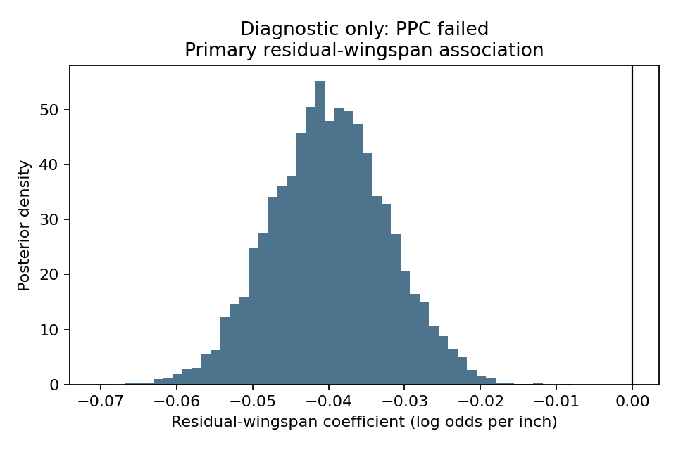
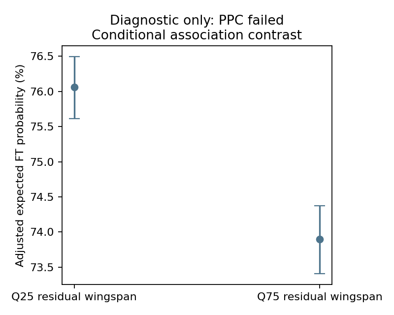
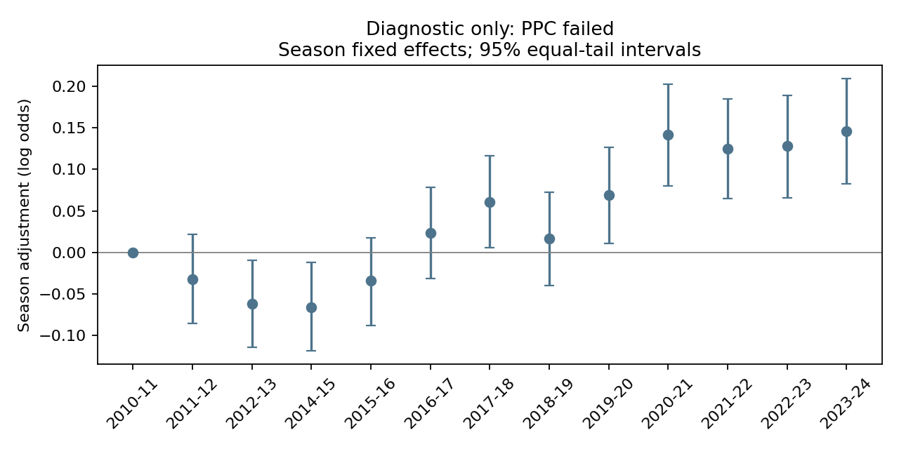
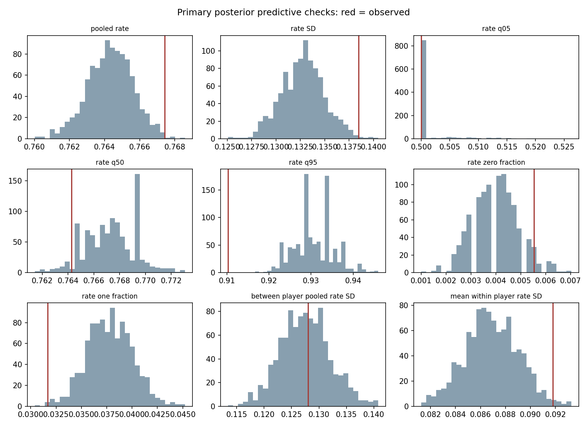

# Stage 3C — Primary Multi-Season Hierarchical Replication

**Execution: FAIL — primary posterior predictive adequacy gate failed.** The sampler passed its numerical and visual diagnostics. Successful sampling does not establish model adequacy. The primary record is frozen with `scientifically_reportable=false`; all coefficient and contrast summaries below are **diagnostic descriptions of the failed model**, not an accepted replication conclusion. The secondary full-panel fit was not run. No specification or gate was changed to obtain a desired association.

## 1. Audit/provenance chain

Stage 0B froze eligibility and geometry; Stage 0C validated historical anthropometrics; Stage 1/2 developed the single-season association. Original Stage 3 remains BLOCKED under its original minute rule. Stage 3A remains UNRESOLVED about internal NBA minute precision. Stage 3B prospectively amended the source-release protocol and authorized this first multi-season inference. A SHA256 preservation manifest and final tests verify that prior artifacts remain unchanged; historical failures were not rewritten as successes.

## 2. Stage 3B authorization

Verified `part_b_authorized=true` and linked gate/receipt hashes before fitting. Primary panel SHA256: `1c34331385e459ac5da67105658730d31d96c8114bd25fcb3b31cea52f1a1871`. Full panel SHA256: `5306ffd228fb71b34b174d18cf86e351b6fa48598579e4f49935078239662978`. Both match Stage 3B. No panel rebuild, measurement-vector change or shooting-data recollection occurred.

## 3. Scientific objective

Evaluate whether the negative 2013–14 residual-wingspan association generalizes across other available seasons while representing repeated players, season effects, persistent player heterogeneity and extra-binomial variability. The intended replication assessment remains unresolved because the frozen model-adequacy gate failed.

This analysis estimates associations within NBA players with available combine measurements. It does not identify a causal effect of arm length on shooting, because combine participation, NBA selection, role assignment, persistent player differences, shooting opportunity and other factors may jointly affect the observed sample.

## 4. Primary replication population

13 seasons; 4,117 player-seasons; 857 players; 469,099 FTA. **2013–14 is excluded.** The likelihood contains 3,980 positive-FTA rows with no minimum-FTA threshold. The 137 zero-FTA rows remain in population accounting. All 857 players remain deterministically indexed, including 22 with no attempts in the primary panel; those 22 random effects have prior information only. Repeated player-seasons are not independent players.

## 5. Frozen residual-wingspan exposure

Residual wingspan = observed wingspan − (4.574910520685837 + 1.0013410045156863 × barefoot height), in inches. The Stage 1 transformation was reused exactly and not refitted. Height center = 77.53028004667445 inches, the outcome-independent primary unique-player mean. Residual inches remain uncentered, retaining zero. Original combine position labels, including hybrids, remain separate; missing/blank maps to unknown. Reference position is C; reference season is 2010-11.

## 6. Hierarchical beta-binomial model

FTM_it ~ BetaBinomial(n=FTA_it, alpha=mu_it×kappa, beta=(1−mu_it)×kappa).

logit(mu_it) = beta_0 + beta_RW×residual_wingspan_i + beta_H×centered_height_i + position_effect_i + season_effect_t + u_i.

Non-centered player effects: z_i ~ Normal(0,1); u_i=sigma_player×z_i. kappa=exp(log_kappa); rho=1/(1+kappa). FTA is the denominator only. There are no minutes, age, experience, team or other new predictors. No alternate model family was substituted.

## 7. Identification interpretation

Residual wingspan, height and position are time-invariant. The wingspan coefficient is identified by **between-player variation**, conditional on the hierarchical random-effects assumptions. Repeated seasons do not create within-player exposure identification. Random intercepts do not control all player ability or remove all omitted player characteristics. A player fixed-effects model cannot separately estimate this time-invariant exposure and was not attempted as a substitute.

## 8. Priors

Frozen at 2026-09-28T22:58:53.621086+00:00, before prior simulation and fitting: beta_0 ~ Normal(0,2.5); beta_RW and beta_H ~ Normal(0,0.5); each nonreference position and season effect ~ Normal(0,1); sigma_player ~ HalfNormal(1); log_kappa ~ Normal(3,2). No statistical prior, formula, exposure or covariate was changed after seeing a posterior.

## 9. Prior predictive check

1,000 prior draws. Fraction mu<0.01: 0.097449; mu>0.99: 0.097802. Quantiles 2.5%, 25%, 50%, 75%, 97.5%: 0.000897, 0.083927, 0.479190, 0.907916, 0.999251. All values were finite. These broad priors passed the predeclared gross-boundary screen (neither tail above 25%); this is not a claim that the prior closely represents NBA FT rates. No observed exposure association was examined to tune the prior.

## 10. MCMC diagnostics

Four PyMC NUTS chains; 2,000 tuning and 2,000 retained draws each (8,000 retained total); target_accept=0.95; seed=20260928. Maximum R-hat=1.007891; minimum bulk ESS=589.83; minimum tail ESS=906.15; divergences=0; maximum-tree-depth hits=0; minimum BFMI=0.674. Key fixed-effect/variance covariance is finite. Every position and season coefficient was included in the diagnostic gate. Trace densities overlap, trace bands are stationary, and energy distributions overlap without an obvious pathological pattern. No diagnostic recovery run was needed.

Two initial launches failed with fork-related macOS crashes/EOFError; a subsequent uncompiled run was interrupted after a measured slow gradient. None produced an inspected posterior. Spawned workers and validated [PyTensor NUMBA compilation](https://pytensor.readthedocs.io/en/latest/library/compile/mode.html) resolved these computational issues while retaining the exact model and PyMC NUTS sampler. The compiled initial-point gradient matched the reference within rtol=atol=1e-8. Every failed/interrupted attempt is preserved. No prior-stage environment was changed.

## 11. Primary beta_RW result — diagnostic only

mean -0.039918; median -0.040009; SD 0.007727; 95% equal-tail CrI [-0.054949, -0.024563], in log odds per residual inch. The median is negative and the interval excludes zero. Estimated P(beta_RW<0)=1.000000: all 8,000 retained draws were negative. This empirical estimate does not establish literal certainty. The result is conditional on a model that failed its PPC gate and must not be presented as successful scientific replication.

## 12. OR interpretation — diagnostic only

OR per residual inch: mean 0.960897; median 0.960781; SD 0.007425; 95% equal-tail CrI [0.946534, 0.975736]. This is a conditional odds ratio under the failed model, not a percentage-point change or causal effect.

## 13. Q25/Q75 probability contrast — diagnostic only

Primary accounting player-season quantiles: Q25=-1.180850, Q75=1.823844 residual inches. Repeated seasons contribute their observed frequency. Each draw retains observed height, original position, season and fitted player random effect, replaces only residual wingspan, and averages equally across 3,980 positive-FTA rows.

Q25 probability: mean 0.760572; median 0.760609; SD 0.002262; 95% equal-tail CrI [0.756127, 0.764952]. Q75 probability: mean 0.738927; median 0.738973; SD 0.002468; 95% equal-tail CrI [0.734068, 0.743726]. Difference Q75−Q25, in percentage points: **mean -2.164548; median -2.169525; SD 0.419298; 95% equal-tail CrI [-2.981571, -1.330323]**. Empirical P(difference<0)=1.000000.

The optional u=0 reference-player difference is mean -2.264392; median -2.268300; SD 0.439543; 95% equal-tail CrI [-3.116516, -1.390330] percentage points. It is not a population average marginalized over new-player heterogeneity. Both are adjusted model-based association contrasts; neither overcomes the PPC failure or establishes causality. Synthetic predictor combinations can also involve extrapolation.

## 14. Player heterogeneity

Sigma_player: mean 0.378730; median 0.378486; SD 0.012803; 95% equal-tail CrI [0.353878, 0.404663] on the logit scale. At a hypothetical fixed baseline probability 0.75, ±1 posterior-median sigma gives approximately 0.6726 and 0.8141. This illustrates model scale only. Individual random effects are neither ranked nor published.

## 15. Extra-binomial heterogeneity

Kappa: mean 168.118514; median 167.714372; SD 10.713221; 95% equal-tail CrI [148.717331, 190.240139]. Rho: mean 0.005937; median 0.005927; SD 0.000375; 95% equal-tail CrI [0.005229, 0.006679]. Rho represents remaining player-season extra-binomial variation after the persistent player intercept. It is smaller than Stage 2's approximately 0.0299; longitudinal random intercepts can absorb some variation previously represented by single-season dispersion. This does not establish that the remaining model fits adequately.

## 16. Season effects

Saved in `stage3c_evidence/primary_season_effects.csv`, relative to 2010-11. These are adjustment terms, with no season-specific hypothesis search, significance ranking or season-varying wingspan slopes.

## 17. Posterior predictive checks — FAILED

1,000 conditional beta-mixture/binomial replications, seed 20260929, retain observed FTA and fitted player effects. Observed makes/attempts = 360,001/469,099. Replicated mean makes = 358544.8; 95% predictive interval [357279.8, 359702.5].

Observed pooled rate is **76.7431%**, compared with replicated mean **76.4326%**, 95% predictive interval **[76.1630%, 76.6794%]**, and 99% interval **[76.0937%, 76.7278%]**. Only 4/1,000 replicates reach or exceed the observed rate. The observed value lies just above the 99% bound (0.0153 percentage points above it); the finite-simulation boundary should not be exaggerated, but the predeclared rule is binding. No extra PPC draws or threshold changes were used to seek a pass.

The frozen serious-failure rule is pooled rate outside its 99% interval, OR at least three of six global rate-distribution metrics outside 99%, OR at least one-third of season pooled rates outside 99%. The pooled-rate condition triggers; two global metrics and zero season metrics are outside 99%.

Additional systematic discrepancies support concern beyond the narrow pooled boundary:

| Metric | Observed | Replicated mean |
|---|---:|---:|
| Pooled FT%, FTA 1–9 | 68.405% | 73.263% |
| Pooled FT%, FTA 10–49 | 71.528% | 73.651% |
| Pooled FT%, FTA 100–299 | 76.635% | 76.168% |
| Pooled FT%, FTA 300+ | 79.044% | 78.117% |
| Overall player-season rate Q95 | 91.028% | 93.059% |
| Fraction of player-seasons with perfect FT rate | 3.166% | 3.781% |

Each listed metric is outside its 99% predictive interval. FTA 50–99 Q95 also misses. Observed overall rate SD and mean within-player rate SD are above their 95% bounds but inside 99%; between-player pooled-rate SD is well represented. All season pooled rates fall inside 99% intervals. Complete intervals and tail fractions are in `primary_PPC_metrics.csv`.

The model overpredicts low-attempt rates and underpredicts high-attempt rates; this describes a model-check pattern, not a proven mechanism. FTA remains a denominator, with no new predictor added. These are conditional checks for observed players, not out-of-sample validation. **Stage 3C scientific inference is not yet adequate.**

## 18. Comparison with Stage 1/2

This comparison was made only after the failed primary result was frozen at 2026-09-28T23:29:33.063073+00:00. Its diagnostic posterior median −0.040009 has the same negative direction and slightly greater absolute magnitude than Stage 1 M2 −0.03531 and Stage 2 beta-binomial −0.03771. This is descriptive numerical agreement, not accepted replication evidence. Different populations and models also limit direct equivalence. 2013–14 is development evidence; overlapping players mean that even an adequate cross-season analysis would not be an independent-player replication.

## 19. Secondary full-panel result

**Not run because the primary PPC gate failed.** The verified full panel contains 14 seasons, 4,428 player-seasons, 866 players and 511,686 FTA, including 2013–14. `full_panel_result.json` explicitly records `NOT_RUN_PRIMARY_PPC_FAILED`, with no invented coefficient. `full_panel_fixed_effects.csv` contains only its schema and no estimates. The fitting guard rejects a secondary run when the primary is not scientifically reportable. Any future full-panel result would include development evidence and would not be independent replication.

## 20. Selection limitation

Previously approved Stage 3 evidence gives approximately 51%–67% measurement coverage across seasons. No new outcome-based selection comparison was calculated. The hierarchy does not correct selection into combine participation, available anthropometrics, NBA survival or shooting opportunity. Random intercepts do not solve selection.

## 21. Stage 3B minute-display limitation

> Public NBA game-level minute displays and the archived game records agreed at the available whole-second resolution in the audited sample, while small discrepancies remained between summed game displays and NBA season-level decimal minute displays. Because season-level MIN was not the scientific outcome, exposure, or primary model predictor, and because shooting counts and analytical eligibility reconciled, the amended prospective validation protocol treated season-total MIN as an ancillary representation field rather than an exact numerical release gate. The internal NBA aggregation mechanism remains unknown.

## 22. What the model does NOT establish

This analysis estimates associations within NBA players with available combine measurements. It does not identify a causal effect of arm length on shooting, because combine participation, NBA selection, role assignment, persistent player differences, shooting opportunity and other factors may jointly affect the observed sample.

The immediate limitation is failed predictive adequacy, especially attempt-stratified calibration and rate tails. More generally, between-player identification relies on the random-effects structure, does not remove all persistent confounding, and remains limited by sample selection, measurement error, frozen geometric-fit uncertainty and informative opportunity. Neither successful sampling nor a negative coefficient overcomes these limitations.

## 23. Reproducibility

Python 3.10.8; PyMC 5.25.1; exact dependencies in `requirements-stage3c.txt`; pip check passed. Isolated environment and traces are locally Git-ignored under `models/stage3c/`. Protocol SHA256: `0fc49add517178355ce8b4572de8696864531952500a284eee4eda4c006a64b3`. The manifest records trace paths, byte sizes, hashes, software, code and evidence hashes.

The failed primary result is immutable. Exact saved-trace numerical/PPC replay: True. Separate same-seed primary sampler reproduction passed: True; posterior arrays exactly equal in this environment: True. Every key-parameter mean must agree within four combined MCSEs. This repeat validates computation and cannot repair the PPC failure; it never replaces the frozen primary result. No bit-identical guarantee is made for different software or hardware.

The freeze code was extended solely to record a failed-PPC artifact rather than requiring success. Replay retains the original analysis code hash and asserts equality of every other result field; both code hashes are recorded. No model, prior, diagnostic threshold or PPC threshold changed. Figures are labeled diagnostic because scientific reportability is false.

## 24. Stage 3C execution decision

**FAIL — PPC adequacy requirement not met.** Sampler convergence passed; scientific model adequacy did not. Verification tests passing does not override this failure. Tests passed: 26/26; final machine-readable decision is `stage3c_evidence/execution_status.json`. Guard tests verify that failure is preserved and full-panel fitting is blocked, rather than asserting that every scientific gate passed. Scientific sign is not an execution criterion.

## 25. Recommended next step

Review the frozen PPC failure before deciding whether to authorize a separately documented model-adequacy investigation. Do not present this coefficient as a validated multi-season replication. The model has not been changed to address the discrepancies. No full-panel fit, Stage 3D sensitivities, FTA-threshold refits, alternate exposures, grouped positions, new subgroups, season-varying slopes or new confounders were run. No causal conclusion, commit or push was made.
