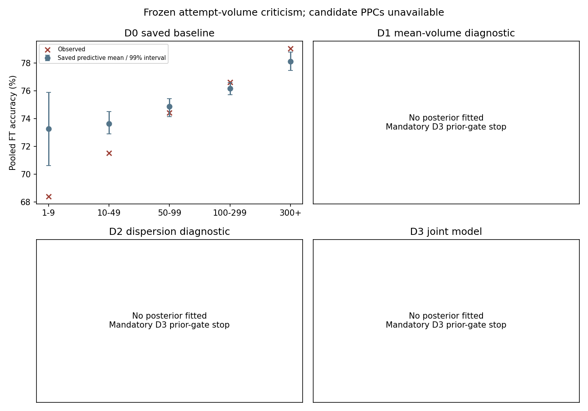
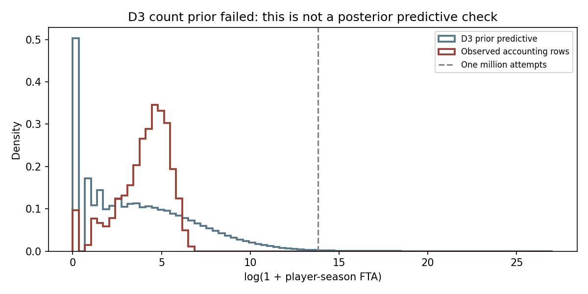

# Stage 3D — Attempt-Volume / Model-Adequacy Investigation

**ADEQUACY UNRESOLVED — D3 FAILS.** D3 failed its **prior-predictive prerequisite**, before any outcome posterior was fitted. This does not mean a fitted D3 posterior failed the conditional or joint PPC: those checks were not run. No revised scientific model is selected; Stage 3E is not authorized.

## 1. Objective

Investigate the failed model's attempt-volume/accuracy calibration, without selecting a structure using the scientific wingspan coefficient. No scientific replication claim is made. Candidate scientific coefficients are sealed; no new coefficient estimate, interval, odds ratio, sign probability or wingspan contrast is available or reported.

## 2. Stage 3C failed PPC

Stage 3C permanently remains **EXECUTION FAIL — PRIMARY PPC ADEQUACY GATE FAILED**. Its numerical sampler diagnostics passed but its model-adequacy gate failed. Stage 3D neither refitted D0 nor generated a new baseline PPC to seek a different result. The exact saved 1,000-replicate output is reused.

The fixed primary panel has 13 seasons, 4,117 player-seasons, 857 players, 469,099 FTA and 3,980 positive-FTA likelihood rows. The 137 zero-FTA rows remain in accounting. 2013–14 is absent. Primary SHA256: `1c34331385e459ac5da67105658730d31d96c8114bd25fcb3b31cea52f1a1871`.

## 3. Why attempt volume may be informative

FTA can carry information about persistent opportunity, role, player quality, foul drawing, rotation security and shooting propensity. Treating it only as a beta-binomial denominator need not represent this dependence. This is an informative attempt-volume, or informative cluster-size, hypothesis. The saved calibration pattern motivates it; no causal mechanism has been established.

## 4. Why direct FTA adjustment changes interpretation

An accuracy model conditional on realized attempts has a different conditioning set from the original between-player model. Attempt volume may itself be downstream of body type, role, skill and playing opportunity. A log-volume term is therefore a diagnostic device here, not an automatically valid primary confounder. GP enters only the joint opportunity model as a fixed exposure offset.

## 5. Frozen candidate ladder

Protocol frozen at 2026-09-29T00:40:57.933949+00:00, before all prior simulations and any candidate posterior fitting; SHA256 `8be5e5b796396ae0edc5d01ba5c1a6b62ceb0928aae6f47d7f0180595b3ea703`.

- D0: exact saved failed Stage 3C reference; no refit.
- D1: add a centered log(1+FTA) term to the accuracy mean; diagnostic only.
- D2: keep the accuracy mean and make log precision linear in centered log(1+FTA); diagnostic only.
- D3: negative-binomial opportunity plus beta-binomial accuracy with correlated player effects; the sole candidate eligible for future scientific use if every prerequisite and adequacy gate passes.

The log-volume center is 4.030428177092034, computed across all 4,117 accounting rows. Height center, raw residual exposure, original position labels and season coding are unchanged. No D4, alternate exposure, regrouping or threshold model is permitted.

## 6. D0 baseline failure

The exact saved values were checked against the fixed primary panel. Bin definitions remain 1–9, 10–49, 50–99, 100–299 and 300+.

| FTA bin | Player-seasons | Total FTA | Observed FT% | Saved D0 replicated FT% | Outside 99% |
|---|---:|---:|---:|---:|---|
| 1-9 | 417 | 1,937 | 68.4047 | 73.2632 | Yes |
| 10-49 | 1,028 | 28,632 | 71.5284 | 73.6507 | Yes |
| 50-99 | 847 | 61,425 | 74.4322 | 74.8707 | No |
| 100-299 | 1,352 | 232,620 | 76.6353 | 76.1678 | Yes |
| 300+ | 336 | 144,485 | 79.0442 | 78.1169 | Yes |

Four of five bins are outside their saved 99% predictive intervals. Both low-volume bins are overpredicted and both high-volume bins underpredicted. The pooled observed rate is 76.7431%, above its saved 99% upper bound of 76.7278%; two global distribution metrics and no season pooled rates miss 99%. The historical failure is retained without recomputing its finite-simulation boundary. The baseline did not save a global unweighted mean-rate metric or batch MCSE; those are not invented. Its four directional bin misses are already outside the broader saved predictive intervals.

## 7. D1 mean-volume diagnostic

The new mean-volume coefficient has Normal(0,0.5) prior; shared parameters retain Stage 3C priors. D1 passed the gross prior accuracy screen: fraction below 0.01=0.103165; above 0.99=0.099479. **No posterior fit occurred**, because the frozen workflow required all prior screens to pass first. No posterior mean-volume coefficient or repaired-PPC claim is available. D1 could not authorize Stage 3E even if it later passed adequacy.

## 8. D2 dispersion-volume diagnostic

Log precision equals gamma_0 + gamma_k×centered log(1+FTA); gamma_0 ~ Normal(3,2), gamma_k ~ Normal(0,0.5). The accuracy mean is unchanged. D2 passed its prior accuracy screen: fraction below 0.01=0.099757; above 0.99=0.095854. **No posterior fit occurred.** The dispersion coefficient and derived rho values at 5, 25, 75, 200 and 400 FTA are unestimated, not zero. D2 is diagnostic only and cannot authorize Stage 3E.

## 9. D3 joint opportunity-accuracy model

Opportunity: FTA_it ~ NegativeBinomial(mu_FTA_it, alpha_FTA), with log mean equal to **log(GP_it)** plus intercept, frozen residual exposure, centered height, original position, season and player opportunity effect. The offset coefficient is fixed at one; GP is not inserted into the accuracy mean. [PyMC's negative-binomial definition](https://www.pymc.io/projects/docs/en/latest/api/distributions/generated/pymc.NegativeBinomial.html) uses variance mu + mu²/alpha.

Accuracy: positive-attempt FTM follows the Stage 3C beta-binomial mean structure, with a player accuracy effect. No realized-FTA mean term is added in D3. All 4,117 rows, including zeros, enter opportunity; only 3,980 positive-FTA rows enter accuracy.

Non-centered bivariate player effects are z×Lᵀ, with columns ordered accuracy/opportunity. LKJCholeskyCov uses eta=2 and two HalfNormal(1) marginal SD priors, following the [documented PyMC construction](https://www.pymc.io/projects/docs/en/stable/_modules/pymc/distributions/multivariate.html). Prior-drawn correlation matrices were symmetric, unit-diagonal and positive definite; this validates construction, not adequacy.

All GP values are positive (range 1–84) and log offsets finite. The preserved 1,510 official GP comparisons remain exact across the three audited seasons; 884 primary-panel rows directly match that census. This is not a newly performed universal official audit. No minute field enters any candidate likelihood.

## 10. Priors and mandatory prior-predictive stop

Suggested priors were retained without amendment. Accuracy: intercept Normal(0,2.5), exposure/height slopes Normal(0,0.5), position/season terms Normal(0,1), log precision Normal(3,2). D1/D2 player SD is HalfNormal(1). D3 opportunity uses intercept Normal(0,2.5), exposure/height slopes Normal(0,0.5), position/season terms Normal(0,1), alpha_FTA HalfNormal(5), and the joint covariance priors above.

Each candidate received 2,000 prior predictive draws with seed 20260928. The accuracy screen retains Stage 3C's finite-probability and 25%-per-boundary-tail rules; all three candidates pass that screen. D3's separate gross-count limits were frozen before simulation: at most 1% of prior player-season mean rates above 100 FTA per game, and at most 0.1% of simulated player-seasons above one million FTA. These intentionally generous scale limits are neither asserted NBA records nor fitted empirical thresholds.

**D3 failed both limits:**

| Prior predictive quantity | Result | Frozen maximum |
|---|---:|---:|
| Fraction with implied mean above 100 FTA/game | 9.3172% | 1% |
| Fraction with simulated FTA above one million | 0.3234% | 0.1% |

Simulated season FTA quantiles: median 28; Q95 13,065; Q99 188,565; Q99.9 5,431,301. Maximum simulated count: 556,450,518,430. Implied mean FTA/game Q95=326.9; Q99=4,451.4. Values are finite nonnegative integers, so this is gross scale implausibility rather than an integer/overflow error.

Broad additive normal priors on a log-rate scale can induce enormous count tails after exponentiation. This result concerns the combined prior; no one coefficient has been isolated as its cause. Following the user-required stop, no outcome posterior was fitted and no prior was tightened after observing this failure. The sampled predictive rows share prior draws; the displayed fractions are Monte Carlo summaries, not millions of independent observations.

## 11. Sampling diagnostics

Planned PyMC NUTS: D1/D2 four chains × 1,500 tune and 1,500 retained; D3 four × 2,000 tune and 2,000 retained; target acceptance 0.95; seed 20260928. D3's one permitted generic recovery would use 0.99 and 4,000 tune/retained draws. **None was run.** No candidate R-hat, ESS, divergence or trace-mixing result exists. D0's saved sampler pass is historical only.

The frozen candidate gate requires R-hat≤1.01, bulk/tail ESS≥400, zero unresolved divergences/max-depth hits, BFMI≥0.3, finite covariance and visual mixing. Sealed scientific parameters may contribute anonymous convergence diagnostics but never effect summaries or raw parameter trace plots.

## 12. Conditional accuracy PPC

Not run for D1/D2/D3. The frozen final assessment requires 2,000 replications; for D3 it holds observed FTA fixed while using joint-posterior information. Failure occurs for pooled rate outside 99%, at least three global metrics outside 99%, at least one-third of season rates outside 99%, at least two FTA bins outside 99%, or the specified opposite low/high-volume pattern beyond Monte Carlo uncertainty.

Global metrics are rate mean, SD, Q05, Q50, Q95, zero fraction and perfect fraction. Within-player repeated-season variability is also checked. For the directional rule, each bin's predictive-mean bias must exceed 2.576 MCSE in magnitude; MCSE uses 40 batches of 50 ordered replicates. Both low bins must agree in sign and both high bins have the opposite sign. These definitions were frozen before candidate results. The number of remaining D3 bin failures, pooled-rate status and pattern repair are **unknown**.

## 13. Joint FTA PPC

Not run. The planned joint check first generates FTA for all rows, then FTM conditional on those generated attempts and the same correlated player-effect draw. It checks overall, season and original-position count distributions, zero frequency, Q25/Q50/Q75/Q90/Q95, and season totals. Failure occurs if zero frequency misses 99%, at least three quantiles miss 99%, or at least five of 13 season totals miss 99% in the same direction. This opportunity gate is additional to the conditional accuracy gate.

The displayed count figure is a **prior** check, not evidence about fitted opportunity adequacy. Requested D3 conditional-PPC and correlation-posterior figures were not produced because no posterior exists; no substitute plot impersonates those results.

## 14. Opportunity/accuracy correlation interpretation

No posterior corr_uv mean, median or interval is available. A future positive value would indicate that higher persistent opportunity-per-game propensity tends to accompany higher persistent accuracy propensity under that joint model; a negative value would indicate the opposite. This is associational latent structure, not causation. Prior correlations cannot answer this question.

## 15. Model adequacy comparison

| Candidate | Sampler | Conditional accuracy PPC | Joint FTA PPC | Future eligibility |
|---|---|---|---|---|
| D0 | Saved pass | Saved fail; 4/5 bins fail | Not applicable | No |
| D1 | Not fitted | Not evaluated | Not applicable | Diagnostic only |
| D2 | Not fitted | Not evaluated | Not applicable | Diagnostic only |
| D3 | Not fitted; prior gate failed | Not evaluated | Not evaluated | No authorization |

`model_adequacy_comparison.csv` contains every requested gate column. Blank values mean unassessed, never pass or zero failures. Overall release adequacy is false when a prerequisite fails. No scientific-effect column is present; no information criterion or p-value ranking was used.

## 16. Final adequacy decision

Decision frozen at 2026-09-29T00:42:56.490872+00:00, before this narrative: **ADEQUACY UNRESOLVED — D3 FAILS**. Selected future model: **NONE**. The qualification is essential: D3 failed prior admissibility, and its posterior structural adequacy remains untested. This does not prove the joint model would fail under every defensible prior specification. No new candidate or model amendment was introduced.

## 17. Whether Stage 3E is authorized

**No.** The authorization artifact records false and `scientific_parameter_status=NOT_AUTHORIZED`. The scientific coefficient remains sealed; indeed, no new candidate posterior exists. Passing D1 or D2 alone cannot authorize Stage 3E. Only D3 can, after every prior, sampler, conditional/joint adequacy, no-post-hoc-change and firewall requirement passes.

## 18. What remains unresolved

Whether direct mean adjustment, varying dispersion or correlated opportunity/accuracy propensity repairs the original volume pattern is unknown. The immediate next issue is prospectively justifying an opportunity prior on the count/per-game scale. This run does not amend it or proceed past the mandatory stop. No posterior coefficient, dispersion pattern or latent correlation is inferred from a prior simulation.

## 19. Selection and minute limitations

Previously approved measurement coverage is approximately 51%–67% across seasons. None of these candidate structures corrects selection into combine participation, anthropometric availability, NBA survival or shooting opportunity. No outcome-based selection comparison was recalculated. Fixed measurements and eligibility remain unchanged.

> Public NBA game-level minute displays and the archived game records agreed at the available whole-second resolution in the audited sample, while small discrepancies remained between summed game displays and NBA season-level decimal minute displays. Because season-level MIN was not the scientific outcome, exposure, or primary model predictor, and because shooting counts and analytical eligibility reconciled, the amended prospective validation protocol treated season-total MIN as an ancillary representation field rather than an exact numerical release gate. The internal NBA aggregation mechanism remains unknown.

## 20. Reproducibility and firewall verification

The exact pinned Stage 3C environment is reused without installation or modification; `requirements-stage3d.txt`, `environment.json` and pip-check evidence record it. Stage 3D caches/outputs are separate. All prior artifacts, including original traces, are hash-protected. Stage 3C has not been rerun or overwritten. The local ignored Stage 3D NPZ contains only prior predictive counts/means and covariance draws, not posterior coefficients.

Execution order: `stage3d_protocol.py`; `stage3d_model.py prior D1`, then D2 and D3; `stage3d_decision.py`; `stage3d_report.py`; `verify_stage3d.py`. The fit entry point refuses to proceed after any failed prior screen. One pre-freeze schema-name correction mapped GP to the ledger's actual `games_played` field; it changed no data or criterion.

The pure selection function accepts only a typed record of Boolean gates, with no trace, filesystem access or parameter summaries. Tests reject effect-summary injection and show that D1/D2 cannot authorize future inference. Report/comparison/decision artifacts are checked for prohibited scientific-effect output. Tests cover prior covariance validity and model initial-point count parameters; they do **not** claim posterior diagnostics were performed.

Verification: 24/24 tests passed. No FTA threshold filtering, full-panel fit, new confounder, causal claim, commit, push or Stage 3E execution occurred. GP is used solely as the opportunity offset. The manifest records file paths, sizes and hashes; unperformed outputs explicitly say NOT_RUN or NOT_ESTIMATED.
