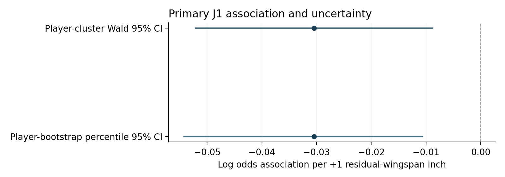
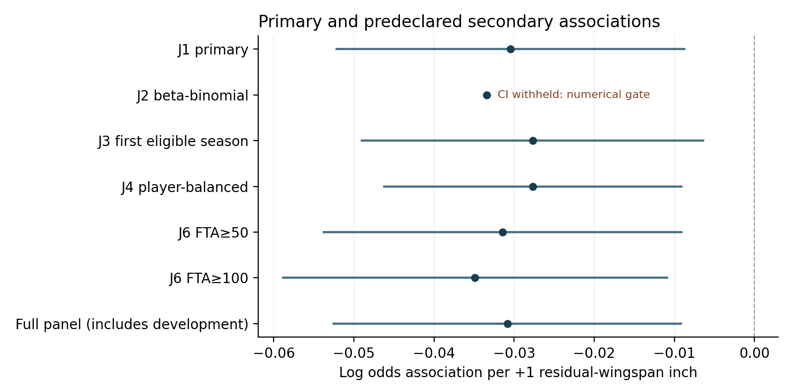
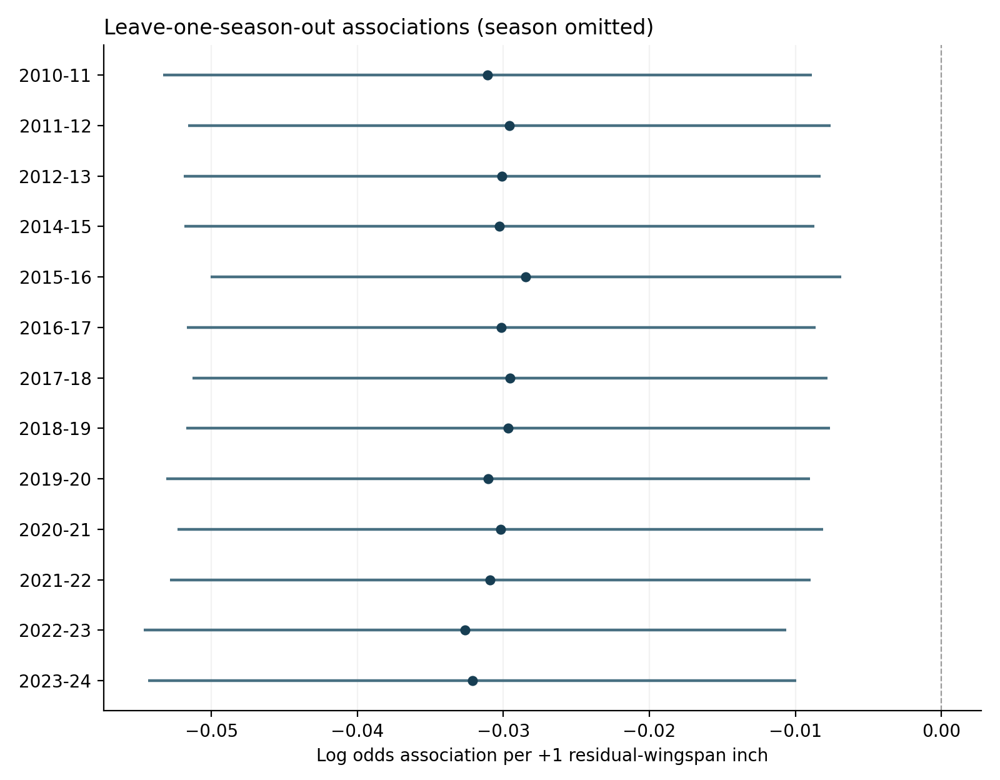
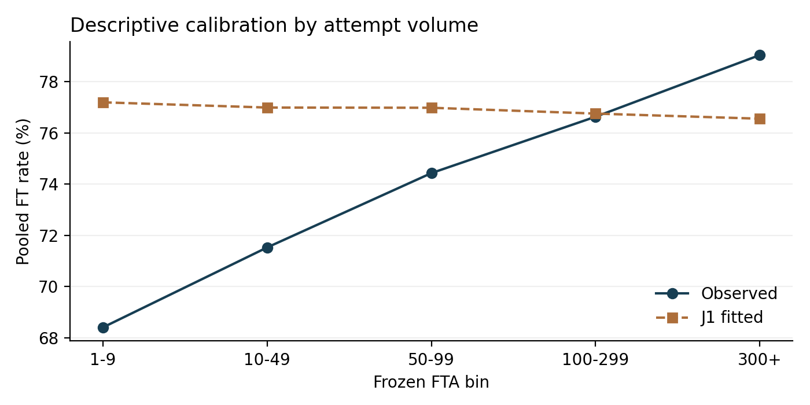
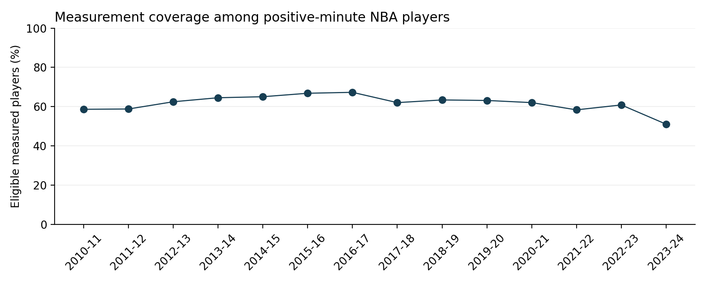

# Stage 3J — Simplified Multi-Season Repeated-Measures Inference

The primary adjusted association is negative: beta=-0.030452, OR=0.970007 per additional residual-wingspan inch. The player-bootstrap 95% interval excludes zero. The estimate describes between-player association in the observed measured-player sample. All predeclared point estimates are negative; J2 bootstrap uncertainty is withheld because its frozen numerical gate failed. Their different magnitudes and available uncertainty remain visible.

## 1. Why complex model development was stopped

Stage 3C sampled but failed its frozen PPC. Stage 3F/F-R exposed weak identification and difficult geometry in richer correlated latent structures. Stage 3H shared-factor candidates sampled reliably but failed predictive adequacy. Stage 3I I1 sampled but did not repair the directional accuracy pattern; I2 and I3 failed sampler gates after their permitted recoveries, leaving their PPCs unassessed. These permanent failures are unchanged. Stage 3J answers a simpler association question under its own prospective inferential protocol; it does not rehabilitate those models. No historical Stage 3C/H/I trace was decoded for the scientific coefficient.

## 2. Scientific question

Among NBA players with validated combine measurements, is relative wingspan associated with free-throw accuracy over multiple seasons? This is an associational study. New seasons exclude the 2013–14 development season, but players can overlap development data, so this is not independent-player replication. The protocol is prospective to Stage 3J fitting, not preregistration before all historical data inspection.

## 3. Primary estimand

Conditional population-average association among observed measured player-seasons adjusted for barefoot height, original combine position and season; attempt-weighted through grouped denominator; time-invariant exposure identified between players. The grouped-binomial estimating equation targets a working-logit association; if the conditional mean is misspecified, its coefficient is a population projection whose value depends on the observed attempt and covariate distribution. Robust covariance addresses dependence and variance, not mean misspecification. It is not a within-player arm-length association or an estimate for all NBA players.

## 4. Replication population

Table 1. Exact released panels; no rebuild. Primary has 4,117 rows, 857 players, 3,980 positive rows, 137 zero rows, and 469,099 attempts. Zero rows remain in accounting and player resampling but contribute no shooting likelihood. Of 857 accounting players, 835 contribute positive attempts; 22 have zero attempts throughout.

| panel | player_seasons | players | seasons | positive_FTA_rows | zero_FTA_rows | contributing_players | FTA | FTM |
| --- | --- | --- | --- | --- | --- | --- | --- | --- |
| primary | 4117 | 857 | 13 | 3980 | 137 | 835 | 469099 | 360001 |
| full_secondary | 4428 | 866 | 14 | 4279 | 149 | 843 | 511686 | 392216 |

Primary SHA256 `1c34331385e459ac5da67105658730d31d96c8114bd25fcb3b31cea52f1a1871`; full SHA256 `5306ffd228fb71b34b174d18cf86e351b6fa48598579e4f49935078239662978`. Unique-player anthropometric summaries are in `sample_anthropometrics_unique_players.csv`; repeated seasons are not counted as independent people.

## 5. Frozen exposure

Residual wingspan = wingspan − (4.574910520685837 + 1.0013410045156863 × barefoot height), in inches. The previously validated transformation is reused exactly, without refitting or measurement changes. Inference conditions on this geometry and does not propagate uncertainty in its fitted reference coefficients.

## 6. J1 model

Grouped response **[FTM, FTA−FTM]**, logit(p)=intercept + residual wingspan + barefoot height + original combine position + season. Height is in raw inches. C and 2010–11 are reference levels. Every hybrid remains separate; missing/blank maps to unknown. There are 28 estimable primary coefficients. No player random intercept, latent opportunity factor, FTA predictor, MIN predictor, realized opportunity decomposition or new confounder enters. A fixed ordered basis removes only absent/aliased dummy columns in resamples/subsets; categories are never pooled and exposure/height must remain identifiable. The MLE is unchanged by this basis reduction.

## 7. Player-cluster uncertainty

For row score s_it=X_it(FTM_it−FTA_it p_it), S_i=Σ_t s_it, bread B=[Σ_it FTA_it p_it(1−p_it)X_itX_itᵀ]⁻¹, covariance=c B(Σ_i S_iS_iᵀ)B. Frozen CR1 correction c=G/(G−1)×(N−1)/(N−K), with G=835 contributing players, N=3,980 positive grouped rows, K=28; c=1.008039216400. The 22 zero-only players are not invented positive-score clusters. Normal-Wald intervals and two-sided normal p-values are asymptotic, not exact with 835 contributors.

Independent matrix calculation matches statsmodels: maximum covariance error 2.16e-12, relative Frobenius error 1.26e-12. Tests verify correction, cluster-label ordering, weighted score/Hessian semantics, and distinct duplicate cluster copies. Full bread, meat, scores and covariance are saved. Primary uncertainty never uses naive binomial covariance.

## 8. Player-cluster bootstrap

Exactly 2,000 replicates, PCG64 seed 20260930. Each samples 857 accounting players with replacement and carries all their seasons, including zero rows, into distinct cluster instances. Positive grouped rows are fitted with frozen coding and exposure. No row resampling, residualization refit, silent replacement or outcome-based selection. NumPy linear-interpolation 2.5/97.5 percentiles and SD with ddof=1 were frozen. Failed fits: 0; successful fits: 2000. More than 20 failures would stop interval interpretation. First three replicate sample hashes and coefficients reproduce for both J1 and J2. These bootstrap fractions are empirical resampling summaries, not posterior probabilities.

## 9. Primary result

Table 2. β=-0.030452, OR=0.970007, 95% CI [-0.052281, -0.008623].

| beta | OR | cluster_SE | CI_low | CI_high | OR_low | OR_high | p |
| --- | --- | --- | --- | --- | --- | --- | --- |
| -0.030452 | 0.970007 | 0.0111375 | -0.0522812 | -0.00862282 | 0.949062 | 0.991414 | 0.00625365 |

Bootstrap mean=-0.03175031, SD=0.01147371, percentile 95% CI [-0.05433056, -0.01047528], fraction β<0=0.999500. Primary result frozen at 2026-10-01T00:51:17.125493+00:00, SHA256 `79b8f461efcc61e0a6e3ff33728fa0d0019839aae03b9809d530f8c9b6906e02`, before every secondary fit.

## 10. Practical interpretation

A one-inch higher residual wingspan is associated with 3.00% lower adjusted FT odds under this fitted model. An odds ratio is not a percentage-point change in accuracy and does not represent changing a player's arm length. Direction, size and uncertainty are separate: the coefficient is negative, the OR is 0.9700, and both reported uncertainty methods must be considered.

## 11. J2 beta-binomial robustness

The unchanged validated Stage 2 likelihood and three-start SciPy optimizer are reused, with the exact J1 mean formula and no player random effect or opportunity model. A common κ models extra-binomial heterogeneity; repeated-player uncertainty comes from a separate 2,000-replicate player bootstrap, seed 20260931, fixed before fitting. β=-0.03342554, OR=0.967127, κ=32.019314, ρ=1/(1+κ)=0.03028531; bootstrap CI **WITHHELD**, failures=299/2,000. The original point fit passed all three starts. The unchanged Stage 2 optimizer often terminated on relative likelihood convergence while at least one start missed the frozen absolute score tolerance in the larger bootstrap panels. Close likelihood agreement does not waive the score check. The numerical audit found this issue; no tolerance was relaxed and no failed replicate replaced. The diagnostic successful-fit percentiles in the raw summary are invalid for interpretation and are not reported as a CI. J2 changes the relative information of differing attempt counts and remains secondary; it cannot replace J1.

Table 3. All predeclared main robustness estimates.

| analysis | player_seasons | players | FTA | beta | ci_low | ci_high | OR | uncertainty |
| --- | --- | --- | --- | --- | --- | --- | --- | --- |
| J1 primary | 4117 | 857 | 469099 | -0.030452 | -0.0522812 | -0.00862282 | 0.970007 | player CR1 |
| J2 beta-binomial | 4117 | 857 | 469099 | -0.0334255 | withheld | withheld | 0.967127 | bootstrap WITHHELD: numerical gate |
| J3 first eligible season | 857 | 857 | 68480 | -0.0276868 | -0.0491156 | -0.00625796 | 0.972693 | HC1 |
| J4 player-balanced | 4117 | 857 | 469099 | -0.0276823 | -0.046365 | -0.00899948 | 0.972697 | player CR1 |
| J6 FTA≥50 | 2535 | 545 | 438530 | -0.0314433 | -0.0539004 | -0.00898633 | 0.969046 | player CR1 |
| J6 FTA≥100 | 1688 | 398 | 377105 | -0.0348819 | -0.0589663 | -0.0107976 | 0.965719 | player CR1 |
| Full panel (includes development) | 4428 | 866 | 511686 | -0.0308281 | -0.0526295 | -0.00902675 | 0.969642 | player CR1 |

## 12. First-season-only robustness

Each of 857 players contributes their earliest chronological eligible replication season, selected without using FTM or FTA. Earliest zero-attempt seasons are retained and never replaced by a later positive season. Positive rows=803, attempts=68,480; β=-0.027687, OR=0.972693, 95% CI [-0.049116, -0.006258]. HC1 uses N/(N−K) times the independent grouped-score sandwich. This sensitivity reduces career-repeat contributions but defines a different observed season distribution; it is not a superior population.

## 13. Player-balanced weighting if justified

Let T_i count all primary accounting seasons, including zero-FTA seasons, and w_it=1/T_i. J4 maximizes sum_it w_it log Binomial(FTM_it | FTA_it, expit(X_it beta)). The grouped response remains [FTM, FTA-FTM]; fractional likelihood weights do not turn counts into fractional trials. Score s_it=w_it X_it(FTM_it-FTA_it p_it); information=sum w_it FTA_it p_it(1-p_it) X_it X_it^T. Cluster meat sums these weighted scores by player before outer products. statsmodels freq_weights implements this powered likelihood; independent score/Hessian checks validate it. The CR1 correction uses actual positive rows and contributing players, not sum(weights). Equal aggregate season weights precede unequal FTA precision; total player information is not equalized.

The mathematical note was hashed before fitting; weighted synthetic scores and Hessian and real cluster covariance validate. β=-0.027682, OR=0.972697, 95% CI [-0.046365, -0.008999]. This changes the target weighting and remains secondary.

## 14. Leave-one-season-out

Exactly 13 omissions; no season removed from the primary fit. β range [-0.03263770, -0.02846941], median=-0.03019642; sign reversals=0.

Table 4.

| omitted_season | beta | ci_low | ci_high | odds_ratio |
| --- | --- | --- | --- | --- |
| 2010-11 | -0.0310999 | -0.0533116 | -0.00888822 | 0.969379 |
| 2011-12 | -0.0296068 | -0.0516113 | -0.00760226 | 0.970827 |
| 2012-13 | -0.0301053 | -0.0519187 | -0.00829195 | 0.970343 |
| 2014-15 | -0.0302622 | -0.0518465 | -0.00867792 | 0.970191 |
| 2015-16 | -0.0284694 | -0.0500694 | -0.0068694 | 0.971932 |
| 2016-17 | -0.0301356 | -0.0516677 | -0.00860354 | 0.970314 |
| 2017-18 | -0.0295518 | -0.0512995 | -0.0078041 | 0.970881 |
| 2018-19 | -0.0296725 | -0.0517196 | -0.00762533 | 0.970763 |
| 2019-20 | -0.0310477 | -0.0530859 | -0.00900951 | 0.969429 |
| 2020-21 | -0.0301964 | -0.0523105 | -0.00808233 | 0.970255 |
| 2021-22 | -0.0308995 | -0.0528508 | -0.00894829 | 0.969573 |
| 2022-23 | -0.0326377 | -0.0546525 | -0.0106229 | 0.967889 |
| 2023-24 | -0.0321395 | -0.0543573 | -0.00992156 | 0.968372 |

## 15. FTA-threshold sensitivities

Only FTA≥50 and ≥100 were used. These change the eligible secondary population and cannot redefine primary eligibility.

| threshold | player_seasons | players | FTA | beta | ci_low | ci_high | odds_ratio |
| --- | --- | --- | --- | --- | --- | --- | --- |
| 50 | 2535 | 545 | 438530 | -0.0314433 | -0.0539004 | -0.00898633 | 0.969046 |
| 100 | 1688 | 398 | 377105 | -0.0348819 | -0.0589663 | -0.0107976 | 0.965719 |

## 16. Alternate exposures

Both frozen secondary exposures use the same height, original positions and season adjustment with player-cluster covariance. Residual wingspan remains primary. Advantage and residual wingspan are exact linear reparameterizations with height and intercept, so their equal coefficient is not independent corroboration. Ratio estimates in the table are per **1.0 ratio unit**, with a per-.01 result saved separately.

| exposure | beta | ci_low | ci_high | odds_ratio |
| --- | --- | --- | --- | --- |
| wingspan_advantage | -0.030452 | -0.0522812 | -0.00862282 | 0.970007 |
| wingspan_ratio | -2.40529 | -4.09634 | -0.714242 | 0.0902392 |

Ratio per .01: {'beta': -0.024052915671693337, 'se': 0.008627960129948107, 'ci_low': -0.04096340678643915, 'ci_high': -0.007142424556947524, 'odds_ratio': 0.976234050310622, 'or_low': 0.9598642538227768, 'or_high': 0.9928830219380627, 'p': 0.005306941260374282, 'ci_includes_zero': False}.

## 17. Secondary full panel

Includes 2013–14 development data: 4,428 rows, 866 players, 14 seasons, 511,686 FTA; β=-0.030828, OR=0.969642, 95% CI [-0.052630, -0.009027]. Run only after the immutable primary receipt and every sensitivity protocol existed. This is **not independent replication** and does not redefine J1.

## 18. Residual / FTA-volume diagnostics

Descriptive pooled residual is Σ(FTM−FTA×p)/ΣFTA. No diagnostic changes the frozen model or acts as a generative release gate.

| group | player_seasons | FTA | FTM | observed_rate | fitted_rate | observed_minus_fitted |
| --- | --- | --- | --- | --- | --- | --- |
| 1-9 | 417 | 1937 | 1325 | 0.684047 | 0.771984 | -0.0879369 |
| 10-49 | 1028 | 28632 | 20480 | 0.715284 | 0.769946 | -0.0546628 |
| 50-99 | 847 | 61425 | 45720 | 0.744322 | 0.769862 | -0.0255401 |
| 100-299 | 1352 | 232620 | 178269 | 0.766353 | 0.767585 | -0.00123248 |
| 300+ | 336 | 144485 | 114207 | 0.790442 | 0.765589 | 0.0248534 |

Overall observed-minus-fitted=4.96e-16; maximum absolute season residual=7.05e-16. Intercept/season score equations make pooled and season calibration essentially exact, so these are not independent adequacy evidence. Fitted probabilities range [0.573664, 0.861738], with 0 below .01 and 0 above .99. Low-volume rates remain overpredicted and high-volume rates underpredicted where the table shows negative and positive residuals. The magnitude is reported without adding FTA or changing the model.

## 19. Opportunity-model limitation

Free-throw attempt volume is the grouped-binomial denominator rather than an accuracy predictor. Earlier analyses demonstrated informative opportunity and predictive misspecification or weak posterior identification. This simpler conditional association does not model the opportunity data-generating process or resolve that limitation. No joint FTA distribution is fitted, and the earlier joint-opportunity PPC is not a Stage 3J release gate. Informative opportunity and incomplete conditional mean specification remain material limits even when robust intervals are precise.

## 20. Between-player identification

Residual wingspan is time invariant, so β_RW is identified **between players**. Repeated seasons add outcome information and support dependence-aware uncertainty; they do not create within-player variation in arm length. A player fixed-effect model cannot estimate this time-invariant exposure and is not used. Dependence adjustment does not control unmeasured player ability, training, role, selection, NBA survival, combine participation or informative opportunity.

## 21. Selection coverage

The approved coverage CSV is copied byte-for-byte, with no FT%-based selection recalculation. Coverage ranges from 51.05% to 67.28% across the approved seasons. Measured players are a selected subset; the model does not correct combine participation, measurement availability or NBA survival selection.

Table 5.

| season | total_positive_minute_players | measured_eligible_players | coverage_rate |
| --- | --- | --- | --- |
| 2010-11 | 452 | 265 | 0.586283 |
| 2011-12 | 478 | 281 | 0.587866 |
| 2012-13 | 469 | 293 | 0.624733 |
| 2013-14 | 482 | 311 | 0.645228 |
| 2014-15 | 492 | 320 | 0.650407 |
| 2015-16 | 476 | 318 | 0.668067 |
| 2016-17 | 486 | 327 | 0.67284 |
| 2017-18 | 540 | 335 | 0.62037 |
| 2018-19 | 530 | 336 | 0.633962 |
| 2019-20 | 529 | 334 | 0.63138 |
| 2020-21 | 540 | 335 | 0.62037 |
| 2021-22 | 605 | 353 | 0.583471 |
| 2022-23 | 539 | 328 | 0.608534 |
| 2023-24 | 572 | 292 | 0.51049 |

## 22. Comparison with Stage 1/2

This comparison is generated after primary freeze. Stage 1 M2 β≈-0.03530985; Stage 2 beta-binomial β≈-0.03770651; J1 β=-0.03045199. J1 has same negative direction; its absolute magnitude is 0.862× Stage 1 and 0.808× Stage 2. These are descriptive comparisons across different models and populations. Stage 1/2 use the 2013–14 development season, excluded from J1; agreement is not forced and repeated players prevent an independent-player claim.

## 23. Scientific interpretation

The primary adjusted association is negative: beta=-0.030452, OR=0.970007 per additional residual-wingspan inch. The player-bootstrap 95% interval excludes zero. The estimate describes between-player association in the observed measured-player sample. All predeclared point estimates are negative; J2 bootstrap uncertainty is withheld because its frozen numerical gate failed. Their different magnitudes and available uncertainty remain visible. Robustness is described by all displayed estimates and their available intervals rather than a composite score or a selected favorable model. The primary interval does not establish absence of confounding, selection or opportunity-related misspecification.

## 24. What the analysis does NOT establish

No causal claim, biomechanical mechanism, within-player arm-length association, solved opportunity process, complete confounding adjustment or all-NBA generalizability is established. Cluster covariance adjusts statistical dependence; it is not control for player effects. Measurement error, small original position categories, frozen geometric-fit uncertainty, unbalanced careers and between-player selection remain.

Stage 3B source limitation, preserved verbatim:

> Public NBA game-level minute displays and the archived game records agreed at the available whole-second resolution in the audited sample, while small discrepancies remained between summed game displays and NBA season-level decimal minute displays. Because season-level MIN was not the scientific outcome, exposure, or primary model predictor, and because shooting counts and analytical eligibility reconciled, the amended prospective validation protocol treated season-total MIN as an ancillary representation field rather than an exact numerical release gate. The internal NBA aggregation mechanism remains unknown.

Official game-display audit scope was 53 player-seasons, not a universal census; season-minute discrepancies remained asymmetric (157 positive, 13 negative). Unobserved DNP rows were not treated as confirmed zeros.

## 25. Reproducibility

Protocol SHA256 `8c2d5908b67018573c655750414cccfa335c37e2dde006a7e8f6ca9fd74bce1d`, frozen 2026-10-01T00:50:16.047527+00:00. 1323 historical artifacts are hash-protected and verified unchanged. Python 3.10.8; packages {'statsmodels': '0.14.5', 'numpy': '2.2.6', 'scipy': '1.15.3', 'pandas': '2.2.3', 'pyarrow': '21.0.0', 'matplotlib': '3.10.3'}. Existing `.venv` reused without installation. Analysis implementation, Stage 2 likelihood and tests are hash-guarded. Initial synthetic test correction and original protocol/receipt/log are retained; no estimation code or scientific specification changed.

Execution commands from the subproject: freeze with `.venv/bin/python scripts/stage3j_freeze.py`; run prefit unittest and save its receipt; run `scripts/stage3j_run.py primary`, then `sensitivities`, then `replay`; build this report with `scripts/stage3j_report.py`; final verification with `scripts/stage3j_verify.py`. J2 exceeded its numerical failure gate. `scripts/stage3j_numerical_audit.py` records the diagnosis without changing the optimizer; `scripts/stage3j_remaining.py` executes the exact hash-guarded AST suffix of the original driver to complete independent predeclared sensitivities. `scripts/stage3j_finalize_j2.py` records the withheld interval after all scheduled draws complete. All analytical commands use the same `.venv/bin/python` and single-thread numerical environment. Freeze and fit commands refuse overwriting immutable results; use tests/replay for existing-artifact verification, not a silent refit. Full log, seed, sample hashes, bootstrap failure records, full covariance, software and build hashes are in `stage3j_evidence/`.

## 26. Stage 3J execution decision

**FAIL**. Final verification records 25 A–Y tests and supplementary artifact checks. The prefit implementation suite passed 25/25. The final suite passes 24/25 and retains one expected observed failure in test R because J2 exceeds the frozen 20-failure cap; the cap was not weakened to produce a passing badge. Execution success requires frozen inputs/protocol, implementation checks before J1, valid sandwich, completed bootstrap, primary freeze before all sensitivities, declared robustness completion and no post-result model tuning. Negative direction, CI exclusion and p<.05 are not success criteria. No generative PPC release gate is reused.

## 27. Recommended manuscript next step

The project now has a clearly specified primary association and two dependence-aware uncertainty estimates, with all predeclared sensitivity results visible. J1 is sufficiently clear to anchor a manuscript-scale **associational** analysis that keeps J1 primary, reports the historical model-development failures and gives informative opportunity, selection and between-player identification prominent treatment. However, Stage 3J as a whole does not receive execution PASS: the predeclared J2 bootstrap numerical gate failed. Before claiming the planned robustness package complete, a separately authorized numerical remedy would need to preserve the original failed record and use the same estimand, likelihood and scheduled samples. No such remedy was improvised here. Readiness of J1 does not establish causal identification or generative adequacy. Stage 4 has not been started. Nothing was committed or pushed.
