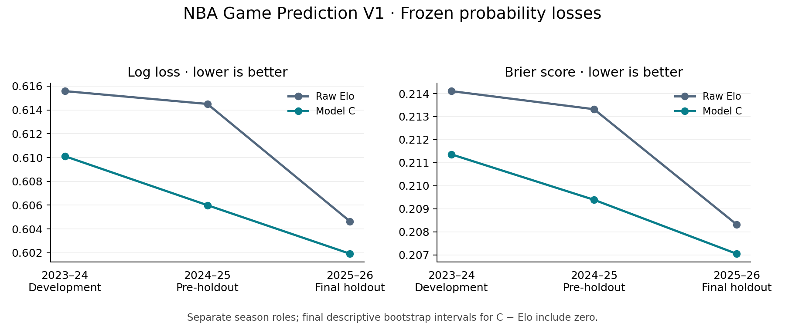

# NBA Game Prediction V1 — Team-Level Probabilistic Modeling

Can we estimate well-calibrated NBA pregame win probabilities using only information available before tip-off?

A probabilistic forecasting study emphasizing temporal leakage control, model comparison and out-of-time validation. **V1 complete / frozen.**

## Dataset and final holdout

Official NBA LeagueGameLog data provide 13,209 accepted regular-season games from 2015–16 through 2025–26. The final holdout contains all 1,230 games in 2025–26.

| Final candidate | Log loss | Brier score | Accuracy | AUC |
| --- | --- | --- | --- | --- |
| Raw Elo | 0.604644 | 0.208328 | 0.674797 | 0.730759 |
| Combined features + Elo logistic | 0.601923 | 0.207053 | 0.676423 | 0.731559 |

[Full-precision metrics for all seven candidates](docs/stage6r2_evidence/final_holdout_metrics.csv). Lower log loss and Brier score are better. The combined model had the best observed final losses, but the predeclared paired date-cluster bootstrap intervals for improvement over Elo included zero. Statistically significant superiority is not established. The bootstrap used 10,000 whole-date draws; no new bootstrap was run for this presentation.



## Method and frozen model

```text
NBA historical games → leakage-safe pregame features → Elo baseline
→ regularized logistic / HGB → chronological validation
→ pre-holdout → final holdout
```

Predict P(designated home team wins). Model C (`features_plus_elo_logistic`) combines 32 team form/schedule features with frozen `elo_logit`: training-median imputation + missingness indicators → StandardScaler → L2 logistic regression (C=0.01, lbfgs, max_iter=5000, tol=1e-4, seed=0). Elo: initial 1500, scale 400, K=20, home advantage 50, offseason alpha=0.50.

## Evaluation and findings

Statistical training: **2015–16 through 2022–23**; development validation: **2023–24**; pre-holdout: **2024–25**; final holdout: **2025–26**. Statistical parameters stay frozen; Elo state advances after completed games.

- All 1,230 final-season games included; no warmup games dropped.
- Model C has the lowest final log loss/Brier among seven frozen candidates.
- Features alone and Elo-only logistic did not beat raw Elo on those losses; HGB did not beat C.
- Calibration is mixed: C has smaller mean bias but higher final fixed-bin ECE than Elo.

## Repository structure

```text
src/                 reusable data and modeling code
tests/               leakage, validation and reproducibility tests
docs/                methodology, V1 report and audit trail
reports/figures/      validated research figures
data/                local caches and derived artifacts, not tracked
```

## Reproduce / verify

From the repository root, run the portable published-evidence check:

```sh
python3 scripts/verify_portfolio.py
```

With the original guarded environment and local archive, the safe synthetic/structural suite remains available from this project directory:

```sh
.venv/bin/python -m unittest discover -s tests -v
```

The [reproduction guide](docs/v1_reproduction.md) records the historical environment and execution restrictions. A public checkout omits raw caches, fitted estimators and environment checkpoints; full historical integrity checks require those original files. The older Stage 7 verifier also expects the prior README/table bytes. This publication preserves those bytes in an [archive](../../../docs/publication/forecasting_README_before.md) and documents the presentation exception in [publication notes](../../../docs/publication/README.md); it does not rewrite scientific manifests to make the old check pass. Do not rerun frozen holdout executors.

## Limitations and V2

Team aggregates omit injuries, player availability and lineups. Historical venue coverage is incomplete; availability is date-based, not verified at exact publication time. One final season and remaining game/team dependence limit inference. **Future V2:** player-aware inputs and richer context; no V2 changes are part of this release.

## Documentation

[Final technical report](docs/v1_final_report.md) · [V1 release summary](docs/v1_release_summary.md) · [Freeze manifest](docs/v1_freeze_manifest.json) · [Feature dictionary](docs/stage1b_feature_dictionary.csv)

Raw NBA data are not distributed here. Data were retrieved from NBA sources through `nba_api`; historical responses may change. This repository does not claim ownership of NBA data. Review source terms before redistributing data.
