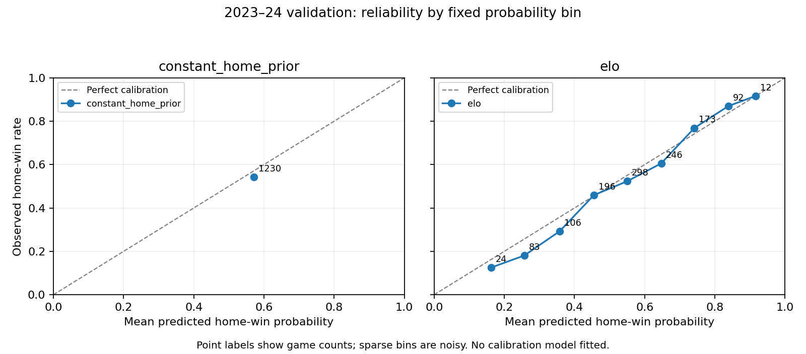

# Stage 2 — Probabilistic baselines and evaluation framework

## 1. Objective and result

**Stage 2 passes.** A training-only constant prior and win/loss Elo baseline were implemented with guarded temporal evaluation, calibration reports and offline reproducibility. There are no feature-based ML models, margin-of-victory updates, player/injury/lineup inputs or betting odds. Stage 3 has not started. No commit or push was performed.

On 2023–24 validation, Elo improves log loss, Brier score, accuracy and ranking over the constant prior. Calibration evidence is mixed; better predictive scores do not establish better calibration. No 2024–25 performance was computed or reported, and no 2025–26 data was retrieved, inspected or used.

## 2. Data and temporal split

The verified Stage 1D inputs are `data/processed/game_features_multiseason.parquet` and `data/interim/game_outcomes_multiseason.parquet`. Their recorded SHA-256 hashes and protected provenance are checked before any modeling read. The dataset has 11,979 unique games across exactly 2015–16 through 2024–25, with matching feature/outcome keys. Stage 1 data and evidence remain unchanged.

| Role | Seasons | Games used in Stage 2 |
| --- | --- | ---: |
| Training history | 2015–16 through 2022–23 | 9,519 |
| Internal scored folds (subset of training) | 2018–19 through 2022–23 | 5,829 |
| External validation | 2023–24 | 1,230 |
| Sealed pre-holdout | 2024–25 | 0 |
| Final holdout | 2025–26 | unavailable / untouched |

Only season, game_id, game_date, home_team_id and away_team_id are projected from the feature file. Only `home_win` is read for permitted seasons and joined explicitly by unique game_id. Neither score column nor any Stage 1B engineered performance feature is read into the model. Full-dataset checks read season/game_id keys only; hashing the whole file is an integrity operation, not outcome evaluation. Predicate-filtered outcome reads exclude sealed labels from the Stage 2 data frame.

## 3. Why 2024–25 remains sealed

2024–25 is reserved for a later approved out-of-time pre-holdout evaluation. Its presence and key coverage are verified, but its labels, predictions, metrics and calibration are excluded from this stage's modeling/reporting flow. `policy.require_open` rejects 2024–25 and 2025–26. `load_games` runs that guard before any file access; Elo, constant fitting, metric evaluation and calibration also enforce it. There is no override in this version. Existing Stage 1 regression tests may exercise their already-authorized structural 2024–25 fixtures, but compute no Stage 2 performance on them.

## 4. Constant home-prior definition

The fitted probability is training home wins divided by training games: **5437 / 9519 = 0.5711734425885072**. Every validation row receives this identical value. Validation outcomes do not enter the fit, and mutation tests prove the isolation. It is a designated-home prior, including neutral-site designated sides.

## 5. Elo equations

For ratings available before the game:

```text
p_home = 1 / (1 + 10 ** (-(R_home + H - R_away) / 400))
delta = K * (home_win - p_home)
R_home_after = R_home_before + delta
R_away_after = R_away_before - delta
```

The probability and both pregame ratings are recorded before the update. Only binary W/L updates the state. The two rating changes sum to zero. Games are sorted by actual calendar date within season; game ID is only a deterministic tie breaker among games involving different teams. Same-team/same-date ambiguity is rejected rather than resolved with game-ID ordering. No random split or shuffled model generation is used.

## 6. Initialization and season regression

Each team starts at 1500 on first appearance. At each new season, existing team states shrink once:

```text
R_newseason = 1500 + alpha * (R_previous - 1500)
```

Elo's carryover policy is distinct from the unchanged Stage 1B feature-history reset policy. The selected alpha retains half of the prior deviation from 1500. Parameters stay frozen during external validation, while ratings legitimately update after earlier completed validation games. The first validation state comes exclusively from training history plus the chosen offseason regression.

## 7. Internal chronological parameter selection

The pre-result `stage2_evidence/protocol.json` declares the exact 80 candidates: K ∈ {10,20,30,40}, H ∈ {0,50,75,100,125}, alpha ∈ {0.50,0.75,0.90,1.00}. All candidates initialize in 2015–16. The first three seasons (3,690 games) form initial history; the subsequent five training seasons are expanding chronological scoring folds. Each game is predicted before its own update, and completed fold games become legitimate history for the next fold.

Select by **pooled game-weighted log loss over 5,829 internal scored games**, without season reweighting. Deterministic tie break uses unrounded log loss, then lower Brier score, smaller K, smaller H, and larger alpha. Accuracy and ROC-AUC are recorded but never used to optimize. No grid expansion or automated broad search was performed.

`select_parameters` filters to training before reading outcome values. The selected configuration is saved to `selected_elo_parameters.json` before validation labels are requested. A fresh full training-plus-validation replay then uses only those frozen parameters. No validation result feeds back into selection.

Selected-candidate fold evidence:

| season | n_games | log_loss | brier_score | accuracy | roc_auc |
| --- | --- | --- | --- | --- | --- |
| 2018-19 | 1230 | 0.619480 | 0.215091 | 0.659350 | 0.697050 |
| 2019-20 | 1059 | 0.629054 | 0.219503 | 0.655335 | 0.694787 |
| 2020-21 | 1080 | 0.645801 | 0.227526 | 0.612037 | 0.671645 |
| 2021-22 | 1230 | 0.636584 | 0.222696 | 0.650407 | 0.687529 |
| 2022-23 | 1230 | 0.646807 | 0.227449 | 0.632520 | 0.650357 |

## 8. Selected K, H and alpha

**K = 20, H = 50, alpha = 0.50.** Pooled internal log loss: **0.635471800**. The top five candidates are:

| K | H | alpha | folds | n_scored_games | log_loss | brier_score | accuracy | roc_auc |
| --- | --- | --- | --- | --- | --- | --- | --- | --- |
| 20 | 50 | 0.500000 | 5 | 5829 | 0.635472 | 0.222409 | 0.642306 | 0.680125 |
| 20 | 50 | 0.750000 | 5 | 5829 | 0.636429 | 0.222832 | 0.639218 | 0.678590 |
| 30 | 50 | 0.500000 | 5 | 5829 | 0.637480 | 0.223143 | 0.639389 | 0.678510 |
| 20 | 75 | 0.500000 | 5 | 5829 | 0.637955 | 0.223567 | 0.634414 | 0.679892 |
| 20 | 50 | 0.900000 | 5 | 5829 | 0.638638 | 0.223741 | 0.636301 | 0.676755 |

Alpha lies at the lower edge of the predeclared grid. That is a limitation of this modest baseline search, not a reason to expand the search after seeing external validation. The full 80 rows and all 400 candidate-fold rows remain reviewable.

## 9. 2023–24 external validation metrics

Exactly 1,230 validation games are scored for each model:

| model | split | n_games | log_loss | brier_score | accuracy | roc_auc |
| --- | --- | --- | --- | --- | --- | --- |
| constant_home_prior | 2023-24 validation | 1230 | 0.691031 | 0.248932 | 0.543089 | 0.500000 |
| elo | 2023-24 validation | 1230 | 0.615578 | 0.214107 | 0.649593 | 0.711416 |

Log loss uses natural logarithms and clips only within its logarithm calculation to `[1e-15, 1-1e-15]` for numerical safety. Brier score uses the original probabilities. Accuracy predicts home win at p ≥ 0.5. ROC-AUC uses the Mann–Whitney rank statistic with average ranks for ties; a single-class sample is explicitly undefined (`roc_auc_defined=false`), not silently set to 0.5. Empty, missing, nonfinite or invalid inputs fail rather than disappear. No scikit-learn dependency was necessary.

## 10. Calibration results

Fixed bins are `[0,.1), [.1,.2), …, [.9,1]`. All ten rows are retained, including zero-count bins with explicitly missing summary means. Both models also have secondary equal-frequency tables; tied constant predictions remain one bin instead of being arbitrarily split.

Constant predicted probability is 0.571173; the validation designated-home win rate is 0.543089, so it overpredicts by **2.808 percentage points**. Elo's mean prediction is 0.562708, overpredicting by **1.962 points**. Elo has nine populated fixed bins; the low and high tails have only 24 and 12 games respectively.

| bin | lower_bound | upper_bound | count | mean_predicted_probability | observed_home_win_rate |
| --- | --- | --- | --- | --- | --- |
| 0 | 0.000000 | 0.100000 | 0 |  |  |
| 1 | 0.100000 | 0.200000 | 24 | 0.162052 | 0.125000 |
| 2 | 0.200000 | 0.300000 | 83 | 0.256835 | 0.180723 |
| 3 | 0.300000 | 0.400000 | 106 | 0.357571 | 0.292453 |
| 4 | 0.400000 | 0.500000 | 196 | 0.455374 | 0.459184 |
| 5 | 0.500000 | 0.600000 | 298 | 0.550634 | 0.523490 |
| 6 | 0.600000 | 0.700000 | 246 | 0.647320 | 0.605691 |
| 7 | 0.700000 | 0.800000 | 173 | 0.741701 | 0.768786 |
| 8 | 0.800000 | 0.900000 | 92 | 0.838333 | 0.869565 |
| 9 | 0.900000 | 1.000000 | 12 | 0.916461 | 0.916667 |

As a descriptive summary only, fixed-bin expected calibration error (count-weighted absolute bin error) is **0.028084 for the constant prior** and **0.033128 for Elo**. Elo has smaller average bias but slightly worse fixed-bin ECE. Consequently, **we cannot claim Elo is better calibrated overall**. The constant occupies a single bin and cannot express game-specific strength; cross-model ECE is bin-dependent and affected by sampling noise. Lower Elo Brier score reflects combined probability quality, not calibration alone. No recalibration model or significance claim was fitted.

The secondary Elo table has ten groups of 123 games and provides another view of the nonuniform errors. These tables are descriptive validation evidence, not a tuning signal in Stage 2.



The matplotlib figure was visually inspected: both model panels, diagonal, axes and bin counts are readable.

## 11. Comparison between prior and Elo

Elo reduces log loss by 0.075454 and Brier score by 0.034825. It also improves discrimination (ROC-AUC 0.711416 versus 0.5). These are observed differences on one external validation season, not a claim of statistical significance, universal superiority or future-season performance. Calibration remains imperfect as detailed above.

## 12. Temporal leakage and baseline tests

New Elo tests verify prediction-before-update, target mutation, future mutation, shuffled-input invariance after internal chronological sorting, zero-sum updates, strict probability bounds, equal-rating/no-advantage behavior, home-advantage direction, exact offseason regression including alpha endpoints, and parameter isolation from external validation outcomes. Other tests reject ambiguous team dates, ensure GAME_ID is not chronology, ignore injected score/engineered-feature columns, and reject invalid parameters/outcomes.

Constant tests check training-only wins/counts, invariance to validation outcome mutation and sensitivity to a training outcome change. The real prediction file contains exactly one constant value. Guards reject sealed/final-holdout requests before loader access. Loader spies verify column projection and permitted-season filters, and a corrupted hash stops before dataframe access.

## 13. Metric tests and total results

Hand-checkable tests cover log loss, Brier score, accuracy at exactly 0.5, AUC including pairwise comparisons and ties, single-class undefined AUC, exact/near-zero and one probabilities, all decimal calibration boundaries, empty bins, equal-frequency conservation, missing/infinite inputs, invalid probabilities/outcomes, empty evaluation and mixed sealed-season frames.

**107 tests pass: all 71 existing Stage 1 tests plus 36 new Stage 2 tests.** No old test assertion was removed or weakened in this stage. All tests ran with socket creation blocked. Individual results and test-file hashes are stored in `test_run.txt` and `test_summary.json`.

## 14. Reproducibility, dependencies and artifacts

Run from the active subproject:

```sh
.venv/bin/python scripts/run_stage2_baselines.py
.venv/bin/python -m unittest discover -s tests -v
```

The Stage 2 runner blocks network socket access itself. Two complete socket-blocked runs reproduce selected parameters, predictions, audit log, grid/fold results, metrics, fixed/equal-frequency calibration tables and the plot. `replay_verification.json` records deterministic hashes; `build_manifest.json` records input/code/protocol/requirements hashes, the grid, chosen parameters and library versions. File-wide outcome hashes preserve input integrity without using sealed labels in fitting or scoring.

Outputs:

- `data/processed/stage2_predictions_2023_24.parquet`: 1,230 × 10, identity keys, home_win, both probabilities and both pregame ratings. This is explicitly an **evaluation artifact containing the target**, not a future X feature table. No score columns are included.
- `data/interim/stage2_elo_game_log.parquet`: 10,749 × 12, chronological training-plus-validation pregame ratings, probability, binary outcome, delta and after-update ratings. No 2024–25 predictions occur.
- `docs/stage2_evidence/`: protocol, grid/fold results, frozen selection, validation metrics, calibration tables, tests, provenance and replay results.
- `reports/figures/stage2/calibration_2023_24.png`: two-panel fixed-bin reliability plot.

Matplotlib 3.10.9 and its required plotting dependencies were added and pinned in `requirements.txt`; all pre-existing package versions were retained. `pip check` passes. The original requirement file is preserved in `stage2_evidence/requirements_before.txt`, with additions recorded in `dependency_changes.json`. Historical Stage 1 manifests retain their original lockfile hash; the Stage 1B historical exact-lockfile gate remains intentionally unchanged and requires that archived lockfile when reproducing its original environment. Stage 2 verifies the immutable Stage 1D data hashes and records its new environment separately. No raw/interim Stage 1 artifact or earlier evidence was rewritten.

## 15. Known limitations

A uniform designated-home H applies to all games, including the bubble and neutral-site games, because historical neutral-site coverage is incomplete. No selective H=0 adjustment was made. Binary Elo omits margin, roster change, injuries, player strength and engineered form. Offseason shrinkage is a common fixed rule, not a team-specific roster model. Source calendar dates lack original intraday availability or revision timestamps; the established date-based contract remains in force. A single external season provides limited calibration evidence, and tail bins are sparse. Internal folds vary in size, particularly pandemic seasons, and pooled scoring weights games equally. A boundary alpha and small grid limit optimization deliberately. No holdout performance or uncertainty-adjusted significance claim is available.

## 16. Stage 2 exit criteria

Pass: training-only prior; pre-update Elo probabilities; parameters selected strictly within training; external 2023–24 validation only; sealed 2024–25 performance; untouched 2025–26; implemented and tested log loss/Brier/calibration/accuracy/AUC; passing temporal tests and all prior tests; deterministic socket-blocked full runs; and no feature-based ML model. Validation state updates are permitted; parameter updates are not.

## 17. Recommended Stage 3 scope — not started

After separate approval, implement leakage-safe regularized logistic regression using the Stage 1B features. Predeclare early-season missingness handling, fit preprocessing only on training data, select regularization through training-internal chronological folds, freeze the recipe before external validation, and compare probability quality/calibration against the frozen Elo baseline. Keep 2024–25 sealed until specifically authorized. No Stage 3 code or modeling was started.
