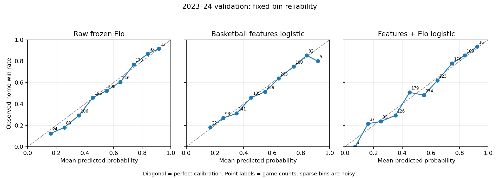

# Stage 3 — Leakage-safe regularized logistic regression

## 1. Objective and research question

Do the 32 existing pregame basketball form/schedule features add predictive information beyond the frozen Elo specification? **Stage 3 passes its implementation and evaluation gates.** On 2023–24 external validation, the predeclared combined model (C) modestly improves log loss and Brier score over raw Elo and features-only model A. Features-only A and Elo-only logistic B do not beat raw Elo on those primary scores. Model C's fixed-bin calibration error and accuracy are worse than raw Elo; the result is not universal improvement.

No tree/boosting model, odds, injury/player/lineup feature, new basketball feature or post-hoc calibrator was added. No commit or push was performed. Stage 4 has not started.

## 2. Data policy and temporal split

Inputs are the immutable Stage 1D `data/processed/game_features_multiseason.parquet` and `data/interim/game_outcomes_multiseason.parquet`. Full keys establish 11,979 unique games and matching feature/outcome keys across exactly 2015–16 through 2024–25, with no 2025–26 rows. Protected Stage 1/2 hashes, frozen Stage 2 parameter artifact and Stage 2 source/output hashes were verified before fitting. Existing artifacts remain unchanged.

| Role | Seasons | Games |
| --- | --- | ---: |
| Final logistic training | 2015–16 through 2022–23 | 9,519 |
| Internal CV scoring subset | 2018–19 through 2022–23 | 5,829 |
| External validation | 2023–24 | 1,230 |
| Sealed pre-holdout | 2024–25 | 0 used |
| Final holdout | 2025–26 | unavailable / untouched |

`modeling_data.py` projects only identity keys and the fixed 32-feature allowlist from the feature file for explicitly permitted seasons. It reads only `home_win` from outcomes for those same seasons and joins on game_id with one-to-one validation. Scores are not model inputs. Whole-file hashing and full season/game-ID key inspection are integrity checks, not sealed-outcome evaluation.

## 3. Why 2024–25 remains sealed

2024–25 is present in the validated source but reserved for later separately approved evaluation. No model A/B/C prediction, comparison metric or calibration is generated for it. Shared temporal guards reject that season in the loader before label access and in fitting, prediction, Elo and evaluation. 2025–26 requests fail before file access. No override exists. Existing historical Stage 1 tests still exercise their structural fixtures, without opening any Stage 3 performance for 2024–25.

## 4. Model definitions A/B/C and frozen baselines

| Name | Input columns before imputer indicators |
| --- | --- |
| constant_home_prior | Stage 2 training prior: 5437 / 9519 = 0.5711734425885072 |
| raw_elo | Unmodified Stage 2 pregame probability, K=20, H=50, alpha=0.50 |
| basketball_features_logistic (A) | Exactly the existing 32 basketball features |
| elo_logistic (B) | elo_logit only |
| features_plus_elo_logistic (C) | All 32 basketball features plus elo_logit |

The 32-feature list is copied into `protocol.json` and checked against the code allowlist. It consists of home/away versions of the 13 Stage 1B features plus the six existing differences. No identity, outcome, score, unknown numeric column, new interaction or feature selection enters the matrix. Correlated home/away/difference redundancy is retained deliberately.

Frozen Elo replays chronologically with probabilities computed before each game's binary-outcome update. `elo_logit = log(p / (1-p))`, with 1e-15 clipping only for finite arithmetic. Elo parameters are verified against the frozen artifact and are never retuned. H stays the same for every designated-home game, including known neutral games. Model B is a regularized learned logistic mapping of Elo, not the raw Elo baseline.

## 5. Missingness policy

All early-season games remain. `SimpleImputer(strategy="median", add_indicator=True)` fits medians and identifies missing columns from training rows only. Outcomes are never imputed. Every fold builds a fresh imputer; validation receives transform only. There are 26 indicator columns for A/C in these fitted training datasets, yielding 58 transformed columns for A and 59 for C. B has one transformed column and no missing Elo input.

An all-missing training predictor raises an error rather than allowing silent feature removal. Infinite predictors, invalid/missing outcomes and missing Elo values also fail. Missingness indicators are created only for inputs with missing values in that fold's training data, as defined by scikit-learn's [SimpleImputer](https://scikit-learn.org/stable/modules/generated/sklearn.impute.SimpleImputer.html). No rows are dropped and no full-dataset statistic fills NaNs.

## 6. Preprocessing and fitting pipeline

Each model uses a sklearn Pipeline:

```text
median imputation + missing indicators
→ StandardScaler
→ LogisticRegression(C=selected_C, penalty="l2", solver="lbfgs",
                     class_weight=None, max_iter=5000, tol=1e-4,
                     random_state=0)
```

The complete pipeline fits only fold training rows. Standardization applies to both original features and missingness indicators. L2 logistic behavior follows the tested scikit-learn implementation ([reference](https://scikit-learn.org/stable/modules/generated/sklearn.linear_model.LogisticRegression.html)); no optimizer was implemented manually. Training rows are sorted deterministically and numerical thread pools are limited to one. Convergence warnings stop a fit instead of being hidden. There were no convergence failures. Final iterations were A=24, B=4, C=27, well below the 5,000 limit.

Final coefficients and preprocessing are fixed before external evaluation. Only Elo state updates after earlier completed validation games. A saved before/after state comparison verifies that validation prediction does not alter the fitted logistic pipelines.

## 7. Internal temporal cross-validation

Five expanding folds fit 2015–16 through the season immediately before the scored season:

| Fold | Training ends | Scored season | Scored games |
| --- | --- | --- | ---: |
| 1 | 2017–18 | 2018–19 | 1,230 |
| 2 | 2018–19 | 2019–20 | 1,059 |
| 3 | 2019–20 | 2020–21 | 1,080 |
| 4 | 2020–21 | 2021–22 | 1,230 |
| 5 | 2021–22 | 2022–23 | 1,230 |

Every model/C/fold combination receives a newly fitted pipeline: **105 fold fits** (3 × 7 × 5). Predictions pool over 5,829 games, weighting games equally. Elo state is chronological and pregame, but its K/H/alpha were previously selected across the training history in Stage 2. Therefore these internal stacking CV estimates are development evidence, not an unbiased evaluation of the entire prior Elo selection process. The honest external comparison remains 2023–24.

`logistic_fold_results.csv` contains 105 rows. `fold_fit_audit.json` records training seasons/counts, transformed dimensions and solver iterations for each fit.

## 8. C grid and selection rule

The pre-result protocol fixes C ∈ {0.01, 0.03, 0.10, 0.30, 1.00, 3.00, 10.00}. For each model independently, choose lowest pooled unrounded log loss; break ties by lower Brier score, then smaller C (stronger regularization). Accuracy and ROC-AUC are recorded but do not select C. Solver, penalty, class weights, imputation, scaling and the feature set are not tuned.

Selection filters to training seasons before reading external-validation feature/target values. Selected recipes are written to `selected_logistic_parameters.json`, then all three final pipelines fit the 9,519 training games, before the build requests any 2023–24 labels. The three recipes are evaluated as one predeclared external experiment; replay repeats only verify identical results and do not trigger new model selection.

## 9. Selected C for each model

**C_A = 0.01, C_B = 0.01, C_C = 0.01.** Training-internal results for those choices:

| model | C | folds | n_scored_games | log_loss | brier_score | accuracy | roc_auc |
| --- | --- | --- | --- | --- | --- | --- | --- |
| basketball_features_logistic | 0.010000 | 5 | 5829 | 0.646076 | 0.225201 | 0.634929 | 0.670623 |
| elo_logistic | 0.010000 | 5 | 5829 | 0.636115 | 0.222729 | 0.639732 | 0.679759 |
| features_plus_elo_logistic | 0.010000 | 5 | 5829 | 0.637155 | 0.221058 | 0.643163 | 0.685841 |

All selections lie at the strongest-regularization edge of the predeclared grid. No smaller C values were tried after looking at validation. The complete 21-row grid remains in `logistic_grid_results.csv` so the selection is traceable.

## 10. 2023–24 external validation metrics

Every row uses the same 1,230 games and unchanged Stage 2 metrics:

| model | n_games | log_loss | brier_score | accuracy | roc_auc |
| --- | --- | --- | --- | --- | --- |
| constant_home_prior | 1230 | 0.691031 | 0.248932 | 0.543089 | 0.500000 |
| raw_elo | 1230 | 0.615578 | 0.214107 | 0.649593 | 0.711416 |
| basketball_features_logistic | 1230 | 0.623299 | 0.216899 | 0.644715 | 0.706896 |
| elo_logistic | 1230 | 0.616320 | 0.214478 | 0.642276 | 0.711416 |
| features_plus_elo_logistic | 1230 | 0.610113 | 0.211363 | 0.642276 | 0.721586 |

Log loss uses natural logs and epsilon=1e-15 only for numerical safety; Brier uses unmodified probabilities; accuracy uses p ≥ 0.5; AUC gives half credit to ties. Missing/nonfinite values never disappear silently. All A/B/C probabilities are finite and strictly between zero and one, including season openers.

## 11. Comparison against constant and raw Elo

Recomputed constant and raw-Elo probabilities match Stage 2 exactly, game by game. All reported baseline metric values also match exactly before comparing logistic models; `baseline_regression.json` records this gate. There is no Elo retuning, altered H, margin update or validation refit.

Model A does **not** beat raw Elo on log loss or Brier. Model B's regularized Elo mapping also does **not** improve either primary score; its positive monotonic transformation leaves ROC-AUC unchanged. All three logistic models beat the constant prior on log loss/Brier, but this alone does not answer the incremental-value question.

## 12. Incremental value of basketball features beyond Elo

Delta is **new model minus reference**. Negative log-loss/Brier deltas mean improvement; positive accuracy/AUC deltas mean improvement.

| comparison | delta_log_loss | delta_brier | delta_accuracy | delta_roc_auc |
| --- | --- | --- | --- | --- |
| basketball_features_logistic vs raw_elo | 0.007721 | 0.002792 | -0.004878 | -0.004520 |
| elo_logistic vs raw_elo | 0.000742 | 0.000371 | -0.007317 | 0.000000 |
| features_plus_elo_logistic vs raw_elo | -0.005465 | -0.002744 | -0.007317 | 0.010170 |
| features_plus_elo_logistic vs basketball_features_logistic | -0.013186 | -0.005536 | -0.002439 | 0.014690 |

Model C improves log loss by 0.005465 and Brier by 0.002744 versus raw Elo. It improves both primary scores versus A (deltas −0.013186 and −0.005536). However, C's accuracy is 0.732 percentage points lower than raw Elo and 0.244 points lower than A. These are modest observed probability-score improvements in one external season, not proof of universal or statistically significant improvement. No uncertainty interval was added post hoc. Because B alone does not improve raw Elo, the combined result is consistent with additional basketball information helping within this predeclared regularized model; it is not a causal decomposition.

## 13. Calibration

The unchanged Stage 2 calibration implementation produces all ten fixed bins for every model, with explicit empty-bin rows. Separate equal-frequency summaries are saved for A/B/C. No isotonic fit, separate Platt scaling or other post-hoc calibrator is applied. Model B is the predeclared Elo-only logistic experiment.

| model | fixed_bin_ece | mean_probability | observed_home_win_rate | populated_bins | bins_below_30 |
| --- | --- | --- | --- | --- | --- |
| basketball_features_logistic | 0.016830 | 0.554226 | 0.543089 | 9 | 2 |
| constant_home_prior | 0.028084 | 0.571173 | 0.543089 | 1 | 0 |
| elo_logistic | 0.035762 | 0.569991 | 0.543089 | 9 | 2 |
| features_plus_elo_logistic | 0.043672 | 0.554779 | 0.543089 | 10 | 2 |
| raw_elo | 0.033128 | 0.562708 | 0.543089 | 9 | 2 |

A has the lowest observed fixed-bin calibration error (0.016830), versus raw Elo 0.033128. B is slightly worse (0.035762); C is worse (0.043672), despite C's better log loss/Brier and smaller average overprediction. These diagnostics answer different questions: Brier and log loss reward discrimination and probability quality as well as calibration, while binned ECE is bin-dependent and noisy. Sparse tail bins require caution. C has just three games below 0.1 and 16 above 0.9. No model is chosen or modified based on these external calibration results.



Three separate panels avoid overlapping model lines. The figure, diagonal and count labels were visually inspected.

## 14. Coefficient interpretation

Coefficients are associations **within this regularized predictive model**, per standardized transformed input unit. They are not causal effects or true feature importance. Strongly correlated home/away/difference inputs share signal, so attribution and conditional signs can be unstable or counterintuitive. Indicator coefficients concern standardized missingness, not a raw change from 0 to 1 without rescaling. Intercepts and all preprocessing parameters are saved separately in `fitted_pipeline_state.json`.

Largest positive and negative coefficients for A:

| transformed_feature_name | is_missingness_indicator | standardized_coefficient |
| --- | --- | --- |
| season_win_pct_diff | False | 0.201174 |
| home_season_win_pct_before | False | 0.148954 |
| point_diff_last_10_diff | False | 0.131638 |
| away_is_back_to_back | False | 0.113319 |
| away_season_win_pct_before | False | -0.121582 |
| away_pts_for_avg_last_10 | False | -0.091845 |
| away_point_diff_avg_last_10 | False | -0.069308 |
| home_win_pct_last_5 | False | -0.064503 |

Largest positive and negative coefficients for C:

| transformed_feature_name | is_missingness_indicator | standardized_coefficient |
| --- | --- | --- |
| elo_logit | False | 0.540732 |
| away_is_back_to_back | False | 0.117126 |
| point_diff_last_10_diff | False | 0.096457 |
| home_point_diff_avg_last_10 | False | 0.085652 |
| away_pts_for_avg_last_10 | False | -0.078988 |
| win_pct_last_5_diff | False | -0.065953 |
| home_win_pct_last_5 | False | -0.061907 |
| win_pct_last_10_diff | False | -0.052565 |

Broadly, A emphasizes season win strength and recent point differential, with schedule and scoring terms also present. In C, **elo_logit is the largest standardized association (0.540732)**; away back-to-back status (0.117126) and recent point differential remain among the larger basketball terms. Some recent-win-form terms have negative conditional signs alongside correlated strength variables; do not translate these into causal basketball conclusions. The full coefficient tables preserve all 58 A and 59 C transformed inputs, source names, indicator flags and absolute coefficients. No feature was removed based on these associations.

## 15. Leakage, missingness, model and sealed-data tests

**143 total tests pass: 107 unchanged prior tests plus 36 Stage 3 tests**, all offline with sockets blocked. Tests include:

- Dramatic external feature changes leave training imputer medians and scaler means/scales unchanged.
- Replacing external targets with missing values leaves selected C, preprocessing and coefficients unchanged.
- Future internal-fold outcome mutation cannot alter earlier-fold predictions, including recomputed frozen Elo values.
- Each fold creates a fresh imputer, scaler and classifier; no fitted object is reused across folds.
- Training medians and indicator indices match only training data; outcomes are not imputed; openers and all missing-feature rows are retained.
- Predictions and coefficients are deterministic under row/column shuffle with key alignment; the feature order is explicit.
- Identities, outcomes, score fields and unknown numerical columns cannot enter the allowlisted matrix.
- Target/future outcome mutation preserves its own/earlier Elo logit; frozen K/H/alpha are enforced; B has exactly one input and C exactly 33 before indicators.
- Sealed fitting/prediction/evaluation fails; sealed/final-holdout loading fails before access; real metric and prediction artifacts contain external validation only.
- Provenance corruption stops before data reads; Stage 2 baseline arrays and metrics reproduce exactly.

Tests additionally reject all-missing training columns, infinite predictors, invalid C values and missing targets. No existing test assertion was weakened. `test_run.txt` contains each result; `test_summary.json` records counts and source hashes.

## 16. Reproducibility, artifacts and dependencies

Run from the active subproject:

```sh
.venv/bin/python scripts/run_stage3_logistic.py
.venv/bin/python -m unittest discover -s tests -v
```

The runner blocks network sockets. Two complete socket-blocked replays matched selected C values, fitted states, predictions, metrics, grid/fold results, coefficient/calibration tables, incremental deltas and figure hashes. `replay_verification.json` and `build_manifest.json` record actual checks, code/input/protocol/output hashes and versions. One numerical thread is used for deterministic fitting.

Key outputs:

- `data/processed/stage3_predictions_2023_24.parquet`: 1,230 × 11, identities, home_win and five probabilities. This is explicitly an **evaluation artifact containing y**, not a future model-X table; final scores are absent.
- `docs/stage3_evidence/`: protocol, 21 pooled grid rows, 105 fold rows, choices, fitted pipeline states, five-model metrics, four incremental comparisons, calibration tables, coefficients, tests and provenance.
- `reports/figures/stage3/calibration_2023_24.png`: three-panel reliability figure.

Tested scikit-learn **1.7.2** was added with SciPy 1.15.3, joblib 1.6.0, threadpoolctl 3.7.0 and cloudpickle 3.1.2, all pinned in requirements.txt. Existing package versions were retained; `pip check` passes. The previous requirements file is archived only in Stage 3 evidence and dependency additions are recorded in `dependency_changes.json`. Historical manifests and artifacts are not rewritten to conceal the new environment; their historical lockfile hashes remain intact. Frozen historical environment checks still require the corresponding archived lockfile.

## 17. Known limitations

The result covers one external season and is not accompanied by significance intervals. Logistic internal-CV stacking values reuse a Stage 2 Elo specification previously selected using the same training era. C is at the grid boundary for all models. Median imputation and missingness indicators are a fixed simple policy, not proof of optimal early-season treatment. Strong collinearity prevents simple coefficient attribution. Neutral-site coverage is incomplete, so uniform H remains. Calendar-date availability and retrospective source revisions retain prior-stage limitations. No 2024–25 or 2025–26 performance claim is available.

## 18. Stage 3 exit criteria

Pass requires the exact predeclared basketball features, training-only preprocessing, no lost opener rows, training-internal C selection, zero external influence on fitting/selection, exact raw Stage 2 baseline reproduction, one probability per validation game for A/B/C, explicit incremental results, noncausal coefficient wording, sealed 2024–25, untouched 2025–26, all previous/new tests and deterministic full offline execution. These gates pass. No tree or boosting model was trained.

## 19. Recommended Stage 4 scope — not started

After separate approval, test whether a small predeclared nonlinear/gradient-boosting model improves on the now-frozen logistic + Elo benchmark. Retain the same feature and missingness-availability contract, training-internal chronological selection, primary probabilistic scores and explicit calibration comparison. Keep 2024–25 sealed until its opening is separately approved. Stage 3 suggests modest complementary form/schedule information, but C's calibration weakness merits careful predeclared evaluation rather than validation-driven fixes. No Stage 4 code, tuning or model has been implemented.
