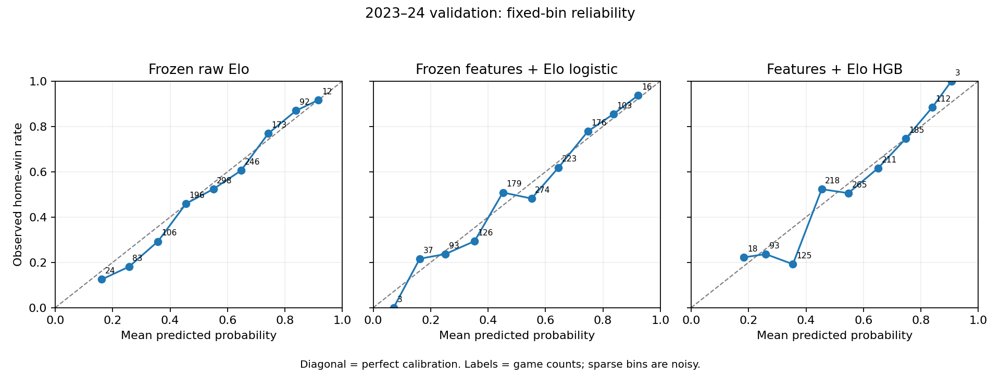

# Stage 4 — Leakage-safe nonlinear gradient boosting

## 1. Scientific question
Can nonlinear relationships among the same pregame basketball features and frozen Elo improve probability quality beyond Stage 3 Model C? The secondary question is whether basketball-only HGB beats raw Elo. This is one model-family experiment, not a search across families.

## 2. Frozen Stage 3 benchmark
The five frozen baselines are loaded from protected Stage 3 prediction artifacts, without refitting or tuning. Their entire prediction arrays, identities, labels and unrounded metrics match exactly; constant and raw Elo additionally match Stage 2. Model C log loss is 0.6101129191413501 and Brier is 0.21136308493395012. Any baseline mismatch raises an error before HGB evaluation. All prior protected artifact hashes remain unchanged.

## 3. Temporal data policy
Training/development: 2015–16 through 2022–23 (9,519 games). External validation: 2023–24 (1,230 games). The Stage 4 build does not read 2024–25 labels or produce predictions or performance for that season. However, running the required legacy Stage 1D tests reread cached 2024–25 scores/outcomes for structural reconciliation and feature checks. This violates a strict no-label-access interpretation; those values were not surfaced or used in Stage 4 fitting, selection or evaluation. 2025–26 remains untouched. Existing shared input provenance checks examine combined-file hashes and identity metadata only; outcome reads are projected and season-filtered. New synthetic sealed-season tests exercise guards without accessing sealed labels; they do not negate the legacy-suite exception.

## 4. Model D/E definitions
D (`basketball_features_hgb`) receives exactly the 32 frozen Stage 1B numerical features. E (`features_plus_elo_hgb`) receives those same 32 plus `elo_logit`. Full ordered allowlists are in `stage4_evidence/protocol.json`. No identity, date, season, outcome, score, new feature, manual cross or feature selection enters either estimator. Elo is unchanged: K=20, H=50, alpha=0.50, chronological pregame win/loss updates and season regression. The existing designated-home convention, including neutral venues, is retained. There is no Elo-only HGB.

## 5. Native missing-value handling
Stage 3 uses training-fit median imputation plus missingness indicators and scaling. Stage 4 passes native NaNs directly to HistGradientBoostingClassifier, with no imputer, scaler or added indicators. All early-season rows remain. The different missing-value mechanism is part of the model family, not additional engineered information. Final input dimensions are exactly 32 and 33; row counts and NaN counts appear in `final_fit_audit.json`.

## 6. Predeclared grid
learning_rate ∈ {0.03, 0.05, 0.10}; max_leaf_nodes ∈ {7, 15, 31}; l2_regularization ∈ {0, 1, 5}. Exactly 27 candidates per model, 54 total. Fixed: max_iter=200, min_samples_leaf=30, max_bins=255, early_stopping=False, random_state=0, loss=log_loss. Other estimator defaults are unchanged in the recorded sklearn version. Only the three declared dimensions vary. Early stopping is disabled to avoid sklearn's automatic sample-based validation split. No API workaround or dependency addition was needed.

## 7. Internal chronological selection
Five expanding fits end in 2017–18, 2018–19, 2019–20, 2020–21 and 2021–22 and score the next season. Scored fold sizes are 1,230, 1,059, 1,080, 1,230 and 1,230 (5,829 pooled). Each candidate/fold gets a fresh estimator: 270 fits. Selection minimizes pooled unrounded log loss; ties use lower Brier, smaller leaf limit, larger L2, then lower learning rate. Accuracy/AUC do not select models. Both choices are persisted before the first validation-label load. Final estimators each fit once on all 9,519 training games; no fitting follows validation access. Fitted-state hashes remain unchanged during scoring. A deterministic replay repeats this same protocol without changing choices.

## 8. Selected parameters
| model | l2_regularization | learning_rate | max_leaf_nodes |
| --- | --- | --- | --- |
| basketball_features_hgb | 5.000000000 | 0.030000000 | 7 |
| features_plus_elo_hgb | 1.000000000 | 0.030000000 | 7 |

Selected pooled internal results:

| model | log_loss | brier_score | n_scored_games |
| --- | --- | --- | --- |
| basketball_features_hgb | 0.642183590 | 0.225518843 | 5829 |
| features_plus_elo_hgb | 0.636840475 | 0.223067291 | 5829 |

## 9. 2023–24 validation results

| model | n_games | log_loss | brier_score | accuracy | roc_auc |
| --- | --- | --- | --- | --- | --- |
| constant_home_prior | 1230 | 0.691031379 | 0.248932013 | 0.543089431 | 0.500000000 |
| raw_elo | 1230 | 0.615577766 | 0.214106595 | 0.649593496 | 0.711416136 |
| basketball_features_logistic | 1230 | 0.623299066 | 0.216898966 | 0.644715447 | 0.706895817 |
| elo_logistic | 1230 | 0.616320031 | 0.214477942 | 0.642276423 | 0.711416136 |
| features_plus_elo_logistic | 1230 | 0.610112919 | 0.211363085 | 0.642276423 | 0.721586187 |
| basketball_features_hgb | 1230 | 0.621926629 | 0.216636919 | 0.645528455 | 0.703816566 |
| features_plus_elo_hgb | 1230 | 0.614538434 | 0.213226576 | 0.645528455 | 0.716065645 |

## 10. Comparison against raw Elo

D does not beat raw Elo on log loss or Brier, although it narrowly improves those metrics over Stage 3 Model A. E narrowly beats raw Elo on both, but has worse log loss and Brier than Model C. Deltas are new minus reference; negative log-loss/Brier deltas improve probability quality. These are descriptive single-season comparisons, with no claim of statistical significance.

| comparison | delta_log_loss | delta_brier | delta_accuracy | delta_roc_auc |
| --- | --- | --- | --- | --- |
| basketball_features_hgb vs raw_elo | 0.006348863 | 0.002530324 | -0.004065041 | -0.007599570 |
| basketball_features_hgb vs basketball_features_logistic | -0.001372437 | -0.000262047 | 0.000813008 | -0.003079251 |
| features_plus_elo_hgb vs raw_elo | -0.001039332 | -0.000880020 | -0.004065041 | 0.004649509 |
| features_plus_elo_hgb vs features_plus_elo_logistic | 0.004425515 | 0.001863491 | 0.003252033 | -0.005520543 |
| features_plus_elo_hgb vs basketball_features_hgb | -0.007388195 | -0.003410343 | 0.000000000 | 0.012249078 |

## 11. Comparison against Stage 3 Model C

The primary comparison has Δlog loss=0.004425515 and ΔBrier=0.001863491. E does not improve both probability metrics on this validation season. The result does not establish a general nonlinear advantage or identify a particular interaction.

## 12. Calibration

| model | bins_below_30 | fixed_bin_ece | populated_bins |
| --- | --- | --- | --- |
| basketball_features_hgb | 2 | 0.035436492 | 9 |
| features_plus_elo_hgb | 2 | 0.050303685 | 9 |
| features_plus_elo_logistic | 2 | 0.043671770 | 10 |
| raw_elo | 2 | 0.033127799 | 9 |

E has higher fixed-bin ECE than raw Elo and Model C; D is slightly worse than raw Elo and better than Model C on this bin-dependent diagnostic. These are the unchanged ten fixed probability bins. ECE is descriptive and bin-dependent; sparse bins are noisy. No calibrator is fitted. The separate-panel figure compares raw Elo, frozen Model C and E, with a perfect-calibration diagonal and bin counts. Figure inputs are saved independently.

## 13. Optional interpretation diagnostics

Permutation importance and partial relationships were explicitly omitted before experimentation to keep this stage focused on the required performance comparison. No feature-level nonlinear or causal finding is claimed.

## 14. Leakage/sealed-data tests

All 166 tests pass (0 failures, 0 errors): the previous 143 plus 23 new Stage 4 tests. New tests cover fresh estimators, future-fold and external-target mutation isolation, training-only final fitting, sealed requests before file access, exact feature allowlists, ignored extraneous numeric/identity/target columns, aligned shuffle invariance, retained NaNs without preprocessing, frozen pregame Elo, exact baseline arrays/metrics and invalid/unknown HGB settings. Prior test files retain their recorded hashes.

## 15. Reproducibility

Run from this subproject with `.venv/bin/python scripts/run_stage4_boosting.py`. The runner blocks socket creation. Two full runs agree byte-for-byte for choices, prediction parquet, metrics, 54 grid rows, 270 fold rows, deltas, calibration tables, figure data and PNG. Build manifests also agree. `replay_verification.json` records hashes; `build_manifest.json` records code/input-protection/protocol hashes and Python/library versions. Tests also run with sockets blocked. `pip check` reports no broken requirements; requirements are unchanged. Single-thread native fits/predictions and deterministic row ordering are used. No commit or push was made.

## 16. Known limitations

One repeatedly consulted development validation season cannot establish generalization. Team-game observations are dependent, and no uncertainty intervals or significance tests are claimed. The small fixed HGB grid can miss other recipes, but was not expanded after validation. Family and missing-value handling change together, so differences cannot be attributed uniquely to interactions. Elo and rolling features update from earlier completed games, including earlier validation games, under the unchanged pregame protocol. No odds, lineup, injury or player information is introduced. Calibration estimates in sparse bins are uncertain.

## 17. Stage 4 exit criteria

QUALIFIED / STRICT EXIT NOT MET: the computational and modeling checks pass, but the strict 2024–25 no-label-access condition failed during the legacy test suite. No 2024–25 predictions or performance were produced, and Stage 4 never used that season. The remaining criteria pass: same feature information; frozen Elo and baselines; chronological internal selection; choices/final fits fixed before validation labels; exact 1,230-game probabilities; explicit E-vs-C comparison; all early rows retained; untouched 2025–26; all tests pass; two offline deterministic builds; exactly one nonlinear family and two new variants. The stage must not be described as an unqualified pass. Future sealed-stage test runs should use synthetic replacements for legacy sealed-season structural fixtures, with explicit data-access guards.

## 18. Recommended next step

Retain frozen Model C as the leading probability-quality benchmark. First isolate legacy structural tests from sealed real-data reads; document the access exception. Review the probability-quality and calibration tradeoffs, then explicitly freeze the candidate set and evaluation protocol before authorizing any pre-holdout opening. Do not broaden this grid based on 2023–24. Keep 2024–25 sealed and 2025–26 untouched until a separate decision.
