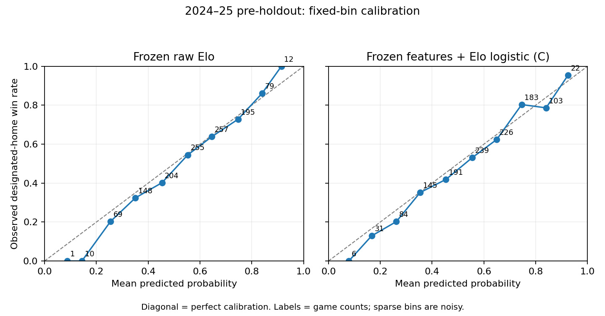

# Stage 5 — One-time 2024–25 pre-holdout evaluation

## 1. Objective
Test whether frozen Stage 3 Model C (`features_plus_elo_logistic`) retains its incremental probability quality over raw Elo in the subsequent 2024–25 season. The primary metrics and comparison were fixed before opening. **Execution passes, and the direction of improvement replicates for both log loss and Brier.** All seven frozen candidates are reported. No uncertainty procedure was predeclared, so no statistical-significance claim is made.

## 2. Explicit authorization
The user's Stage 5 message explicitly authorized one 2024–25 performance opening and only the frozen candidate set. The exact request is preserved in `stage5_evidence/authorization.txt`, with its checksum in the gate and ledger. It did not authorize tuning, feature changes, recalibration or any 2025–26 access. A deterministic replay of the same opened evaluation is authorized solely as reproducibility evidence.

The ordinary Stage 4A policy remains closed. A narrowly scoped Stage 5 session admits only the two validated 2024–25 source paths with exact projections, after the opening gate and ledger. It does not enable historical build commands, a force flag or a global season-policy expansion.

## 3. Frozen candidate set
The unchanged candidate set is constant_home_prior, raw_elo, basketball_features_logistic (A), elo_logistic (B), features_plus_elo_logistic (C), basketball_features_hgb (D), and features_plus_elo_hgb (E). The existing candidate freeze remains byte-identical; no additional family or variant was introduced. Model C was primary before opening, not chosen after observing these results.

## 4. Frozen recipes
Raw Elo remains K=20, H=50, alpha=0.50, initial rating 1500 and scale 400, with binary pregame updates and unchanged designated-home convention. The constant prior is the frozen original-training value 5437/9519. Logistic C_A=C_B=C_C=0.01, median imputation plus indicators, StandardScaler, L2/lbfgs, max_iter=5000, tol=1e-4 and random_state=0. A uses exactly 32 basketball features, B elo_logit, C the same 32 plus elo_logit.

D uses learning_rate=0.03, max_leaf_nodes=7 and L2=5; E uses 0.03, 7 and L2=1. Both retain max_iter=200, min_samples_leaf=30, max_bins=255, early_stopping=False, random_state=0 and log_loss, with native NaN routing and no imputation/scaling. No score, identity, target, neutral-site flag, new interaction or feature subset enters candidate matrices.

Five fitted estimators were reconstructed exactly once using 2015–16 through 2022–23, 9,519 games. No training on 2023–24 or 2024–25 occurred. Their actual fitted objects were serialized before opening, and both opening and replay loaded those objects. Seven historical numerical source modules were recovered with exact pre-Stage-4A SHA-256; only the isolated runtime's temporal permission is overlaid for the authorized season. Original numerical equations and preprocessing code are executed unchanged. The regular project modules remain guarded.

## 5. Pre-opening verification
The gate verified candidate/frozen artifact hashes, Stage 4A code checkpoint (apart from the explicitly documented capability-boundary extension), original numerical source hashes, selected parameters, allowlists, dependencies and requirements. It reconstructed all seven 2023–24 probability arrays and required exact equality to the protected Stage 4 artifact. All unrounded validation metrics also matched exactly, as did all logistic fitted preprocessing/parameter states. A mismatch would stop before any 2024–25 label access.

`preopening_verification.json` records the complete gate and saved-estimator checksum. The original Stage 2–4A documents, predictions, metrics, coefficients, selection and calibration evidence remain unchanged. Reproducing the protected 2023–24 benchmark served as a regression gate, not a new experiment or selection step.

## 6. Opening ledger
Authorization recorded (UTC): `2026-09-24T19:48:28.643094+00:00`. First Stage 5 outcome-decode boundary (UTC): `2026-09-24T19:48:28.644237+00:00`. Decode completed: `2026-09-24T19:48:28.685752+00:00`. Aggregate results persisted: `2026-09-24T19:48:29.369962+00:00`.

`preholdout_opening_ledger.json` was created exclusively before decode; `first_outcome_decode.json` is a separate exclusively created first-decode marker. The start timestamp is recorded immediately before invoking the permitted decoder, rather than an unverifiable claim about the instant a native library materializes its first scalar. The ledger records candidate/protocol/code/gate hashes, training definition, target, metrics, 1,230 expected games and continued final-holdout prohibition. Its final status is `completed`. A new opening is rejected whenever a ledger exists. Incomplete or failed openings stop rather than silently restarting.

This is the first model-performance opening, not a claim of the first historical processing of these source labels: prior Stage 1D structural use and the Stage 4 test exception remain disclosed.

## 7. 2024–25 dataset
Exactly 1,230 validated/reconciled regular-season games were included, retaining all five reconciled neutral-site games and their designated-home mappings. The loader projected only game_id/home_win from `data/interim/reconciled/game_outcomes_2024_25.parquet`; no final score was read into this evaluation. It read identities plus the same 32 pregame features from the frozen season feature artifact. Inputs retained their Stage 1D checksums, and joins were one-to-one with no missing targets, dropped games or outlier removal. Target: P(designated home team wins).

## 8. Prediction protocol
Frozen Elo evolved chronologically from training through completed 2023–24 games, then through 2024–25. Each game probability precedes its target update; parameters never change and margin of victory is absent. Rolling features preserve the established earlier-game and season-reset contract. Logistic/HGB statistical parameters remain frozen on original training history; earlier completed outcomes update the existing pregame information only.

The full season was generated before aggregate evaluation. Each of the seven candidates has one finite probability per game. Fitted-estimator serialization fingerprints were checked before and after prediction and did not change. No post-opening fit, recalibration or recipe change occurred. `data/processed/stage5_predictions_2024_25.parquet` is a 1,230-row evaluation artifact with five identity columns, home_win and seven probability columns; final scores are absent. Individual-game error analysis was deferred entirely.

## 9. All candidate metrics

| model | n_games | log_loss | brier_score | accuracy | roc_auc |
| --- | --- | --- | --- | --- | --- |
| constant_home_prior | 1230 | 0.690798338 | 0.248816283 | 0.543902439 | 0.500000000 |
| raw_elo | 1230 | 0.614499951 | 0.213322240 | 0.660975610 | 0.716798691 |
| basketball_features_logistic | 1230 | 0.618030160 | 0.214774469 | 0.658536585 | 0.711373828 |
| elo_logistic | 1230 | 0.615240332 | 0.213669277 | 0.652845528 | 0.716798691 |
| features_plus_elo_logistic | 1230 | 0.605998402 | 0.209393229 | 0.668292683 | 0.728618285 |
| basketball_features_hgb | 1230 | 0.615622617 | 0.213898541 | 0.662601626 | 0.712913892 |
| features_plus_elo_hgb | 1230 | 0.612074621 | 0.212010166 | 0.660162602 | 0.721454855 |

All rows are 2024–25 pre-holdout. The exact existing metric implementations are used: natural-log loss with existing clipping, original-probability Brier, >=0.5 accuracy and rank-based AUC with ties. Model C has the lowest observed log loss and Brier. This descriptive ordering does not authorize changing candidates or recipes.

## 10. Primary Model C versus raw Elo comparison

| comparison | delta_log_loss | delta_brier | delta_accuracy | delta_roc_auc |
| --- | --- | --- | --- | --- |
| features_plus_elo_logistic vs raw_elo | -0.008501549 | -0.003929012 | 0.007317073 | 0.011819594 |
| basketball_features_logistic vs raw_elo | 0.003530209 | 0.001452229 | -0.002439024 | -0.005424863 |
| features_plus_elo_hgb vs raw_elo | -0.002425331 | -0.001312074 | -0.000813008 | 0.004656163 |
| features_plus_elo_hgb vs features_plus_elo_logistic | 0.006076219 | 0.002616937 | -0.008130081 | -0.007163431 |

Deltas are new minus reference; negative probability-loss deltas improve. Model C's primary deltas are −0.008501549491097049 log loss and −0.003929011660068954 Brier. Its accuracy is higher by 0.00731707317073172 and AUC by 0.0118195939878872. No post-opening metric or comparison was substituted for the primary one.

## 11. 2023–24 versus 2024–25 replication

| split | raw_elo_log_loss | model_c_log_loss | delta_log_loss | raw_elo_brier | model_c_brier | delta_brier | raw_elo_accuracy | model_c_accuracy | raw_elo_auc | model_c_auc |
| --- | --- | --- | --- | --- | --- | --- | --- | --- | --- | --- |
| 2023-24 validation | 0.615577766 | 0.610112919 | -0.005464847 | 0.214106595 | 0.211363085 | -0.002743510 | 0.649593496 | 0.642276423 | 0.711416136 | 0.721586187 |
| 2024-25 pre-holdout | 0.614499951 | 0.605998402 | -0.008501549 | 0.213322240 | 0.209393229 | -0.003929012 | 0.660975610 | 0.668292683 | 0.716798691 | 0.728618285 |

The improvement direction replicates on both probability metrics. The observed reductions are larger than the 2023–24 reductions (about −0.005465 log loss and −0.002744 Brier), rather than disappearing or reversing. Magnitude equality was not required. The two seasons remain separate: 2023–24 was development validation; 2024–25 was the frozen pre-holdout. They were not pooled into a purported untouched test.

## 12. Calibration

| model | bins_below_30 | fixed_bin_ece | mean_predicted_probability | observed_designated_home_win_rate | populated_bins |
| --- | --- | --- | --- | --- | --- |
| basketball_features_hgb | 1 | 0.038573596 | 0.558049734 | 0.543902439 | 8 |
| basketball_features_logistic | 3 | 0.043954178 | 0.560356563 | 0.543902439 | 10 |
| constant_home_prior | 0 | 0.027271004 | 0.571173443 | 0.543902439 | 1 |
| elo_logistic | 3 | 0.032008355 | 0.570949236 | 0.543902439 | 10 |
| features_plus_elo_hgb | 2 | 0.024571962 | 0.558108739 | 0.543902439 | 9 |
| features_plus_elo_logistic | 2 | 0.034008984 | 0.559766972 | 0.543902439 | 10 |
| raw_elo | 3 | 0.024138274 | 0.563652546 | 0.543902439 | 10 |

The existing ten fixed bins are unchanged; empty bins are retained. Model C has higher fixed-bin ECE (0.034009) than raw Elo (0.024138), despite better log loss/Brier. C's mean probability is 0.559767 versus Elo's 0.563653 and observed designated-home win rate 0.543902, so C has smaller overall mean bias. These diagnostics do not establish uniformly better calibration. Sparse bins remain noisy and ECE is bin-dependent. No calibrator was fitted.

The figure was visually inspected; it has separate readable panels, a perfect-calibration diagonal and bin counts. All seven tables, summary values and figure data are saved.

## 13. Tests
**122 tests passed before real opening**, including all 102 current development tests and 20 Stage 5 preflight tests, with no failures/errors/skips. Stage 5 tests use synthetic targets, safe metadata, hashes and mocked reads; they cover candidate/recipe equality, exact source hashes, permitted season and final-holdout rejection, narrow file/column access, no post-opening or replay fitting, original training window, pregame Elo, 1,230-row coverage, score exclusion, the primary comparison, ledger-before-decode ordering, timestamp creation, duplicate decode rejection and the entire synthetic output pipeline. Archived historical fit-based tests remain excluded from ordinary discovery.

The real execution adds mandatory exact validation regression, actual 1,230-row/seven-model coverage, estimator-state invariance and protected-artifact checks. No code or recipe change followed label opening. Final evidence includes `test_run.txt` and `test_summary.json`.

## 14. Reproducibility
Two evaluation executions (initial opening and one replay) produced byte-identical predictions, metrics, calibration tables/summary, comparisons, cross-season table, figure data and PNG. Replay loaded the saved estimators and made zero fit calls. It is **not a second independent test**. `replay_verification.json` records this distinction and the exact output hashes. Network access remained blocked; model/dependency/code hashes are recorded. Stage 2–4A protected artifacts remained unchanged.

The explicit runner has `prepare`, `open` and `replay` modes. Preparation/opening are consumed; do not repeat them. A replay is permitted only against the completed ledger and unchanged gate, code, recipes and estimator bundle. No bug occurred after opening, so the stop-and-document failure policy was not invoked.

## 15. Interpretation
The predeclared Model C advantage over raw Elo replicated descriptively in the subsequent season, supporting complementary value from the frozen basketball features plus Elo under this protocol. Nonlinear E also beats Elo on log loss/Brier but does not beat C. Features-only A and D remain slightly worse than raw Elo on both probability metrics. Elo-only logistic B remains slightly worse than raw Elo.

Notable descriptive shifts from 2023–24: C's accuracy difference versus Elo changes from negative to positive; D moves much closer to Elo without beating its probability scores; E's fixed-bin ECE falls from 0.050304 to 0.024572, while A's ECE rises from 0.016830 to 0.043954. The main probability-quality ordering at the top remains C, then E, then Elo. There is no predeclared threshold for “material” change or statistical significance, so these are observed changes, not significance claims or tuning instructions.

## 16. Known limitations
One pre-holdout season is limited evidence; games and teams are dependent and uncertainty intervals were not predeclared. Development validation had already informed the candidate set. Historical structural label access means the source data were not literally never processed, although no previous 2024–25 model performance guided recipes. Retrospective date-based pregame availability and source revision limitations remain. Uniform designated-home Elo advantage includes neutral sites. Different missingness mechanisms are part of the frozen model families. A replay validates determinism, not additional generalization. Calibration conclusions depend on bins and sparse-tail sampling.

The software capability is a fail-closed boundary for normal supported project commands, not an operating-system defense against deliberate bypass. The 2025–26 prohibition remains independent of Stage 5 authorization.

## 17. What may no longer change after opening
Do not change Elo, C, HGB parameters, seed, preprocessing, missingness, features, training window, model families, calibration, metric definitions, candidate set or game inclusion while calling this the same frozen pre-holdout experiment. Do not select favorable games or quietly repair and rerun a genuine bug. Any new development based on this season must be labeled as development and cannot make it unseen again. No such changes occurred here. The original freeze and all prior evidence remain preserved.

## 18. Status of 2025–26 final holdout
**Completely untouched and forbidden.** No identities, features, outcomes, predictions, schedules or metrics were accessed or fetched. Requests fail before physical data access, including inside an active Stage 5 session. Network sockets remain blocked. Stage 5 authorization does not extend to this season.

## 19. Recommended next scientific step
Keep Model C frozen as the confirmatory candidate and raw Elo as the primary benchmark. Review these results, then predeclare a final-holdout execution protocol and any uncertainty analysis before separately deciding whether to authorize 2025–26. Preserve the seven-candidate reporting commitment and training policy unless a new, explicitly labeled development protocol is chosen. Do not tune on 2024–25, recalibrate based on these results or open 2025–26 automatically. No commit or push was made.
